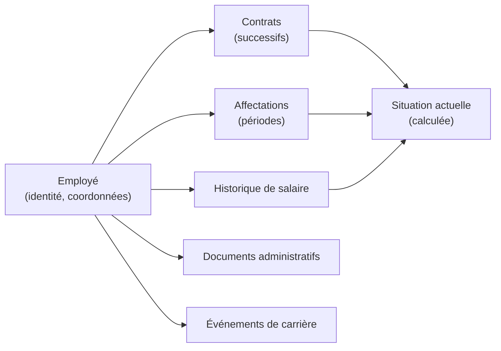
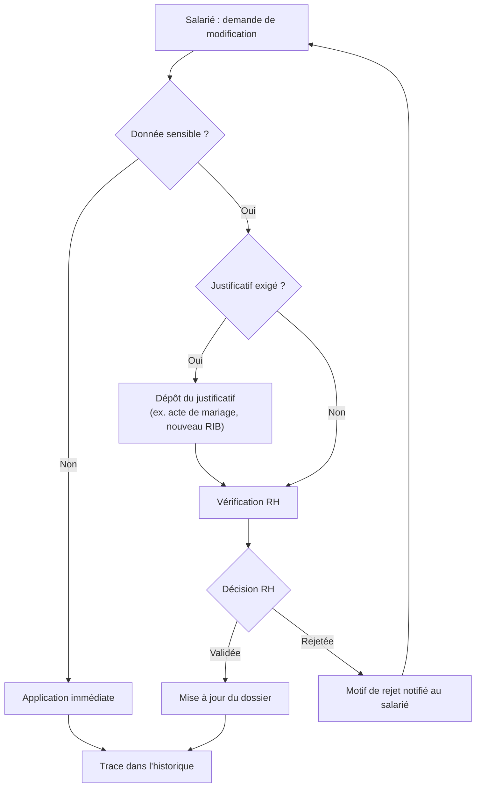
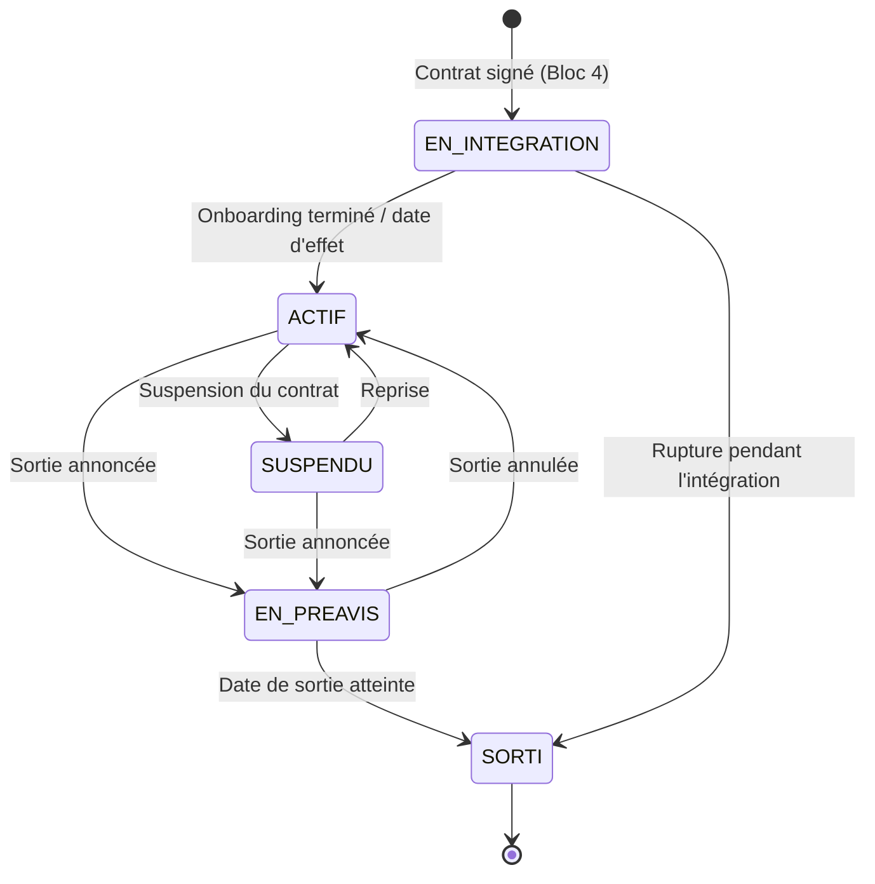
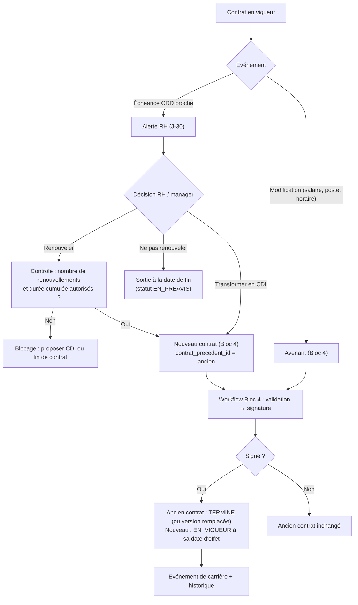
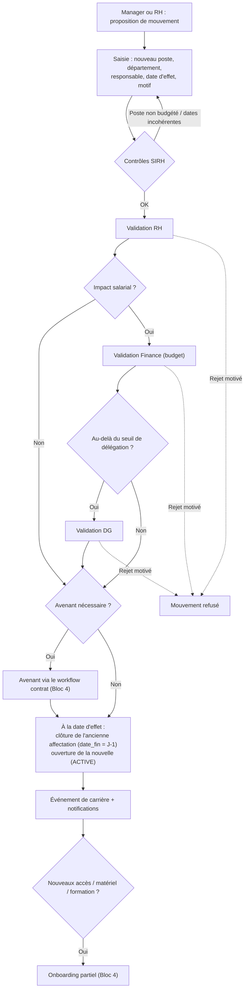
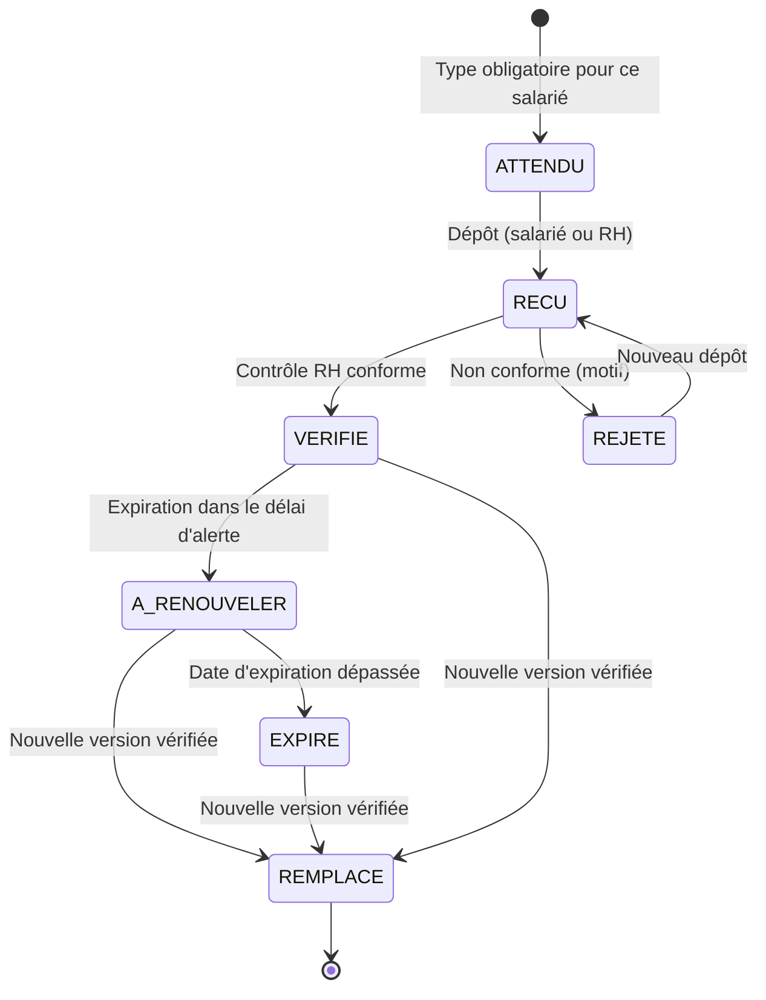
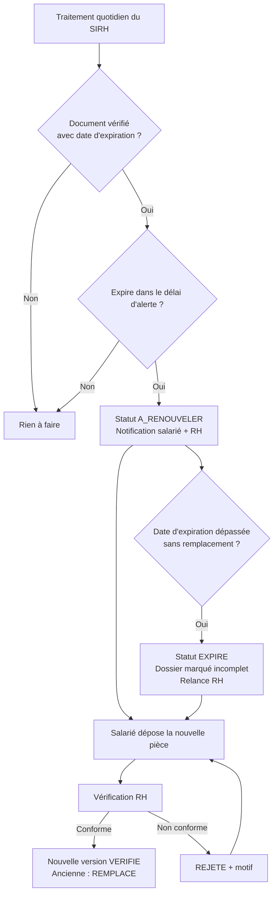
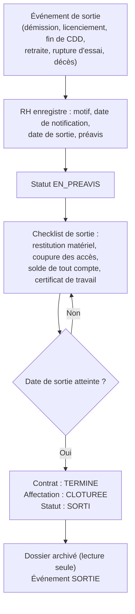
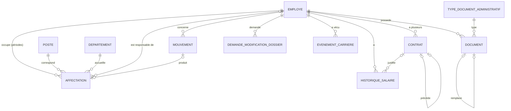

# BLOC 5 — DOSSIER ADMINISTRATIF DU SALARIÉ
## Analyse métier, règles de gestion et workflows d'un SIRH

## 1. Objectif du bloc

Le Bloc 5 centralise, dans un **dossier unique par salarié**, toutes les informations
administratives qui le concernent : identité, coordonnées, situation professionnelle,
contrats, affectations, rémunération, documents administratifs et historique de carrière.

Le Bloc 4 **crée** le salarié, son premier contrat, sa première affectation et ses premiers
documents. Le Bloc 5 **tient ce dossier à jour pendant toute la vie du salarié dans
l'entreprise**, puis le conserve après son départ.

Le dossier doit répondre à trois questions à tout moment :

1. **Qui est le salarié ?** Identité, coordonnées, situation familiale, numéros sociaux.
2. **Où en est-il aujourd'hui ?** Poste, département, responsable, contrat en vigueur, salaire actuel, statut.
3. **Quel a été son parcours ?** Contrats successifs, affectations, révisions de salaire, événements de carrière.

---

# 2. Périmètre fonctionnel

Le Bloc 5 doit permettre de :

- consulter et mettre à jour les informations personnelles du salarié ;
- faire valider par le RH toute modification d'information sensible ;
- connaître la situation professionnelle actuelle (affectation et statut en cours) ;
- gérer plusieurs contrats successifs pour un même salarié (CDD, renouvellement, CDI, avenant) ;
- gérer les changements d'affectation (mutation, promotion, changement de responsable ou de site) ;
- conserver l'historique des salaires ;
- gérer les documents administratifs, leur validité et leur renouvellement ;
- produire un historique de carrière chronologique et non modifiable ;
- archiver le dossier à la sortie du salarié sans le supprimer.

### Répartition entre les blocs

| Bloc | Rôle par rapport au dossier salarié |
|---|---|
| Bloc 3 — Sélection et embauche | Fournit les données du candidat retenu. |
| Bloc 4 — Contrat et onboarding | Crée le salarié, le premier contrat, la première affectation et les documents d'embauche. |
| **Bloc 5 — Dossier administratif** | **Tient le dossier à jour, gère les mouvements, la validité des documents et l'historique.** |
| Bloc 6 — Temps de travail | Lit l'affectation et le régime de travail en vigueur pour appliquer le planning. |
| Bloc 7 — Congés et absences | Lit le statut, l'ancienneté et le contrat en vigueur pour calculer les droits. |

> Le Bloc 5 ne refait pas le workflow de signature d'un contrat : il **réutilise** le
> workflow contrat du Bloc 4 (`BROUILLON → A_VALIDER → A_SIGNER → SIGNE → EN_VIGUEUR`) et se
> charge de l'enchaînement des contrats et de leur trace dans le dossier.

---

# 3. Acteurs du processus

| Acteur | Responsabilités |
|---|---|
| Salarié | Consulte son dossier, demande la correction de ses informations personnelles, dépose ses justificatifs. |
| Responsable RH | Tient le dossier, valide les modifications, vérifie les documents, enregistre les mouvements et les révisions de salaire. |
| Responsable hiérarchique (manager) | Propose une mutation, une promotion ou un changement d'affectation pour son équipe ; consulte le dossier de son équipe en lecture limitée. |
| Finance | Valide l'impact budgétaire d'une promotion ou d'une révision de salaire. |
| Direction générale (DG) | Valide les mouvements ou révisions qui dépassent le seuil de délégation du RH. |
| SIRH | Calcule la situation actuelle, contrôle la cohérence des périodes, surveille les échéances, envoie les alertes et historise chaque changement. |

---

# 4. Principes du dossier salarié

## 4.1. Un dossier, plusieurs objets

Le dossier n'est pas une seule table. C'est une **vue consolidée** construite à partir de
plusieurs objets reliés au salarié :



## 4.2. Situation actuelle calculée, jamais saisie

La situation actuelle (poste, département, type de contrat, salaire) est **déduite** :

- du contrat dont la période couvre la date du jour et dont le statut est `EN_VIGUEUR` ;
- de l'affectation `ACTIVE` dont la période couvre la date du jour ;
- de la dernière ligne d'historique de salaire en vigueur.

Les champs `employe.poste` et `employe.departement` peuvent exister comme raccourci de lecture,
mais ils doivent toujours être **recalculés** à partir de l'affectation active. Ils ne
remplacent jamais l'historique (voir Bloc 4, point 1 : « Le contrat n'est pas un simple champ
du salarié »).

## 4.3. On n'écrase rien

Un changement ne modifie pas l'ancienne donnée : il **clôt** l'ancienne période (date de fin)
et **ouvre** une nouvelle période. Les seules corrections directes autorisées concernent les
erreurs de saisie, et elles sont tracées.

---

# 5. Informations personnelles

## 5.1. Données gérées

| Groupe | Données | Sensibilité |
|---|---|---|
| Identité | Matricule, nom, prénom, date et lieu de naissance, sexe, nationalité, CIN (numéro, date et lieu de délivrance) | Élevée |
| Coordonnées | Adresse, téléphone, email professionnel, email personnel | Moyenne |
| Situation familiale | Situation matrimoniale, nombre d'enfants à charge, conjoint | Élevée |
| Contact d'urgence | Nom, lien, téléphone | Moyenne |
| Numéros sociaux | N° CNaPS, N° OSTIE (ou organisme de santé au travail) | Élevée |
| Données bancaires | Banque, RIB / numéro de compte, mode de paiement | Très élevée |

Le matricule est attribué une seule fois à l'embauche et **ne change jamais**, même en cas de
réembauche.

## 5.2. Workflow de modification des informations personnelles

Le salarié ne modifie pas directement son dossier. Il fait une **demande de modification**
que le RH valide. Les coordonnées non sensibles (téléphone, email personnel, contact
d'urgence) peuvent être appliquées directement si l'entreprise le décide.



États d'une demande de modification : `SOUMISE`, `EN_VERIFICATION`, `VALIDEE`, `REJETEE`, `ANNULEE`.

## 5.3. Règles de gestion — informations personnelles

| Code | Règle |
|---|---|
| RG-IP01 | Chaque salarié possède un matricule unique, attribué à l'embauche et jamais réattribué. |
| RG-IP02 | Le CIN, l'email professionnel, le N° CNaPS et le matricule sont uniques dans le SIRH. |
| RG-IP03 | La modification d'une donnée sensible (identité, situation familiale, numéros sociaux, RIB) passe par une demande validée par le RH. |
| RG-IP04 | Une modification de situation familiale ou de RIB exige un justificatif déposé dans le dossier. |
| RG-IP05 | Chaque modification enregistre l'ancienne valeur, la nouvelle valeur, l'auteur, le validateur et la date. |
| RG-IP06 | Un changement de RIB validé n'est pris en compte en paie qu'à partir de la période de paie suivante, sauf décision RH contraire tracée. |
| RG-IP07 | Le salarié peut consulter l'intégralité de ses propres données personnelles. |
| RG-IP08 | Le nombre d'enfants à charge ne peut pas être négatif ; toute variation est datée car elle peut avoir un effet sur les droits (paie, congés). |
| RG-IP09 | Un rejet de demande de modification est obligatoirement motivé. |

---

# 6. Situation professionnelle

## 6.1. Statut administratif du salarié

Le statut du salarié est distinct du statut du contrat et de celui de l'affectation.

| Statut | Signification | Déclencheur |
|---|---|---|
| `EN_INTEGRATION` | Contrat signé, onboarding en cours. | Création par le Bloc 4. |
| `ACTIF` | Salarié en poste. | Fin de l'onboarding ou date d'effet atteinte. |
| `SUSPENDU` | Contrat suspendu (congé maternité, maladie longue, mise à pied, disponibilité…). | Décision RH ou absence longue venant du Bloc 7. |
| `EN_PREAVIS` | Fin de contrat annoncée (démission, licenciement, fin de CDD non renouvelé). | Enregistrement d'une sortie à date future. |
| `SORTI` | Le salarié a quitté l'entreprise ; dossier archivé. | Date de sortie atteinte. |



## 6.2. Vue « situation actuelle »

La fiche salarié affiche en tête :

- matricule, nom, statut administratif ;
- poste, département, responsable, site (affectation active) ;
- type et référence du contrat en vigueur, date de fin éventuelle ;
- salaire de base en vigueur (visible uniquement par les personnes habilitées) ;
- ancienneté calculée depuis la date d'embauche ;
- alertes : document expiré, contrat arrivant à échéance, dossier incomplet.

## 6.3. Règles de gestion — situation professionnelle

| Code | Règle |
|---|---|
| RG-SP01 | Un salarié `ACTIF`, `SUSPENDU` ou `EN_PREAVIS` a exactement **un** contrat en vigueur à la date du jour. |
| RG-SP02 | Un salarié `ACTIF` a exactement **une** affectation active (principale) à la date du jour. |
| RG-SP03 | La situation actuelle (poste, département, contrat, salaire) est calculée à partir des périodes en vigueur, jamais saisie à la main. |
| RG-SP04 | Un changement de statut administratif est daté, motivé et historisé. |
| RG-SP05 | L'ancienneté est calculée à partir de la date d'embauche ; les règles de reprise d'ancienneté (réembauche, périodes de suspension) sont paramétrables. |
| RG-SP06 | Un salarié `SORTI` ne peut plus recevoir de nouveau contrat ni de nouvelle affectation ; une réembauche rouvre le dossier existant (même matricule) par une nouvelle entrée du Bloc 4. |
| RG-SP07 | Un salarié `SUSPENDU` conserve son contrat et son affectation ; ce statut est transmis aux Blocs 6 et 7. |

---

# 7. Gestion des contrats dans le dossier

## 7.1. Principe

**Un salarié peut avoir plusieurs contrats.** Le dossier présente la chaîne complète :

```
CDD n°1  ──renouvellement──▶  CDD n°2  ──transformation──▶  CDI  ──avenant──▶  CDI (avenant 1)
```

Chaque contrat garde son propre cycle de vie (Bloc 4) et pointe vers le précédent
(`contrat_precedent_id`). Un avenant modifie un contrat existant sans le remplacer : il crée
une nouvelle version liée.

## 7.2. Workflow de succession de contrats



## 7.3. Règles de gestion — contrats

| Code | Règle |
|---|---|
| RG-CT01 | Un salarié peut avoir plusieurs contrats ; tous sont conservés et consultables depuis son dossier. |
| RG-CT02 | Deux contrats d'un même salarié ne peuvent pas être en vigueur sur des périodes qui se chevauchent. |
| RG-CT03 | Un renouvellement, une transformation ou un avenant référence le contrat précédent. |
| RG-CT04 | Le nouveau contrat ne passe `EN_VIGUEUR` qu'après signature (workflow du Bloc 4) ; tant qu'il n'est pas signé, l'ancien reste en vigueur. |
| RG-CT05 | Le nombre maximal de renouvellements et la durée cumulée maximale d'un CDD sont des paramètres à valider avec le droit applicable ; le SIRH bloque un renouvellement qui les dépasse. |
| RG-CT06 | Une alerte est émise avant l'échéance d'un CDD (délai paramétrable, par défaut 30 jours). |
| RG-CT07 | Un CDD arrivé à échéance sans décision ne se renouvelle jamais automatiquement : le RH est relancé, et le dossier est signalé comme anomalie. |
| RG-CT08 | Un avenant ne supprime pas la version précédente ; il en crée une nouvelle avec sa propre date d'effet. |
| RG-CT09 | Toute modification de salaire, de fonction ou de catégorie inscrite dans un contrat ou un avenant met à jour l'historique de salaire et/ou d'affectation correspondant. |

---

# 8. Gestion des affectations et mouvements

## 8.1. Types de mouvements

| Mouvement | Description | Conséquence |
|---|---|---|
| Mutation | Changement de département ou de site, même niveau. | Nouvelle affectation. |
| Promotion | Passage à un poste ou une catégorie supérieure. | Nouvelle affectation + révision de salaire + avenant. |
| Changement de responsable | Le salarié change de supérieur hiérarchique. | Nouvelle affectation (même poste). |
| Changement de poste | Même catégorie, autres fonctions. | Nouvelle affectation, avenant si les fonctions contractuelles changent. |
| Intérim / affectation temporaire | Remplacement pour une durée limitée. | Affectation secondaire datée, retour automatique à l'affectation principale. |

## 8.2. Workflow d'un mouvement



États d'un mouvement : `PROPOSE`, `A_VALIDER`, `VALIDE`, `APPLIQUE`, `REJETE`, `ANNULE`.

## 8.3. Règles de gestion — affectations

Ces règles complètent RG-AF01 à RG-AF07 du Bloc 4.

| Code | Règle |
|---|---|
| RG-MV01 | Un salarié a une seule affectation principale active à une date donnée ; une affectation temporaire peut s'y superposer. |
| RG-MV02 | L'ouverture d'une nouvelle affectation principale clôt automatiquement la précédente la veille de la date d'effet. |
| RG-MV03 | Les périodes d'affectation principale d'un salarié ne se chevauchent pas et ne laissent pas de trou tant que le salarié n'est pas `SORTI`. |
| RG-MV04 | Une affectation ne peut pas commencer avant la date d'effet du contrat en vigueur ni après sa date de fin. |
| RG-MV05 | Le poste cible doit exister et être ouvert dans le département cible. |
| RG-MV06 | Un salarié ne peut pas être son propre responsable ; le responsable doit être un salarié actif. |
| RG-MV07 | Tout mouvement a un motif, un auteur, un validateur et une date d'effet. |
| RG-MV08 | Un mouvement avec impact salarial exige la validation Finance ; au-delà du seuil de délégation, la validation DG. |
| RG-MV09 | Un mouvement validé avec une date d'effet future n'est appliqué qu'à cette date ; il peut être annulé tant qu'il n'est pas appliqué. |
| RG-MV10 | Un mouvement appliqué n'est pas supprimé : une erreur se corrige par un nouveau mouvement ou une correction tracée. |
| RG-MV11 | Une affectation temporaire a obligatoirement une date de fin ; à cette date, le salarié revient à son affectation principale. |
| RG-MV12 | Le changement d'affectation est transmis au Bloc 6 (planning, régime horaire) et peut déclencher un onboarding partiel (Bloc 4). |

---

# 9. Rémunération et historique de salaire

## 9.1. Principe

Le salaire figure dans le contrat, mais il évolue plus souvent que le contrat (augmentation
annuelle, promotion, prime fixe intégrée). On tient donc un **historique de salaire** daté,
indépendant, alimenté par :

- la signature d'un contrat ou d'un avenant ;
- une révision salariale validée (augmentation générale ou individuelle) ;
- une promotion (mouvement avec impact salarial).

## 9.2. Objet `HistoriqueSalaire`

| Attribut | Description |
|---|---|
| `id` | Identifiant. |
| `employe_id` | Salarié concerné. |
| `contrat_id` | Contrat ou avenant de rattachement. |
| `salaire_base` | Montant brut mensuel. |
| `devise` | MGA par défaut. |
| `categorie_professionnelle` | Catégorie / classe au moment de la révision. |
| `date_effet` | Date de prise d'effet. |
| `date_fin` | Fin de validité (nulle pour la ligne en cours). |
| `motif` | EMBAUCHE, AUGMENTATION_GENERALE, AUGMENTATION_INDIVIDUELLE, PROMOTION, AVENANT, CORRECTION. |
| `valide_par_id`, `date_validation` | Traçabilité. |

## 9.3. Règles de gestion — salaire

| Code | Règle |
|---|---|
| RG-SA01 | Le salaire en vigueur est la ligne d'historique dont la période couvre la date du jour ; une seule ligne est en cours à la fois. |
| RG-SA02 | Une révision salariale n'écrase jamais la ligne précédente : elle la clôt et en crée une nouvelle. |
| RG-SA03 | Le salaire de base ne peut pas être inférieur au minimum de la grille salariale de la catégorie, ni au salaire minimum légal en vigueur. |
| RG-SA04 | Une baisse de salaire est bloquée sauf avenant signé par le salarié. |
| RG-SA05 | Toute révision exige la validation Finance ; au-delà du seuil de délégation, la validation DG. |
| RG-SA06 | Une révision avec date d'effet rétroactive est signalée à la paie comme rappel à calculer. |
| RG-SA07 | Le salaire n'est visible que par le RH, la Finance, la DG et le salarié lui-même. Le manager n'y a pas accès. |

---

# 10. Documents administratifs et validité

## 10.1. Types de documents et durée de validité

Chaque type de document est paramétré : est-il obligatoire ? a-t-il une durée de validité ?
avec quel délai d'alerte ?

| Type de document | Obligatoire | Validité | Alerte avant expiration |
|---|---|---|---|
| Copie CIN | Oui | Date d'expiration indiquée sur la pièce, si elle existe | 60 jours |
| Certificat de résidence | Oui | Durée paramétrable (à valider avec le RH) | 30 jours |
| Bulletin n°3 du casier judiciaire | Selon le poste | Durée paramétrable (à valider avec le RH) | — (exigé à l'embauche) |
| Diplômes, attestations | Selon le poste | Sans expiration | — |
| Certificat d'aptitude médicale | Oui | Selon la périodicité de la visite médicale | 30 jours |
| Attestation d'affiliation CNaPS | Oui | Sans expiration | — |
| Acte de mariage, actes de naissance des enfants | Si situation déclarée | Sans expiration | — |
| Relevé d'identité bancaire | Oui | Sans expiration (remplacé à chaque changement) | — |
| Permis de conduire | Si poste de conduite | Date d'expiration de la pièce | 60 jours |
| Autorisation de travail / visa (salarié étranger) | Si étranger | Date d'expiration de la pièce | 90 jours |
| Contrats, avenants signés | Oui | Liés au contrat (Bloc 4) | — |

Les durées et délais sont **paramétrables** et doivent être validés avec le RH et le droit
applicable avant la mise en production.

## 10.2. Cycle de vie d'un document

Le Bloc 4 utilise déjà `ATTENDU`, `RECU`, `VERIFIE`, `REJETE`. Le Bloc 5 ajoute la notion de
**validité dans le temps** :



## 10.3. Workflow de renouvellement d'un document



## 10.4. Objet `Document` — compléments au Bloc 4

| Attribut ajouté | Description |
|---|---|
| `date_emission` | Date de délivrance de la pièce. |
| `date_expiration` | Date de fin de validité (nulle si sans expiration). |
| `document_remplace_id` | Version précédente remplacée par ce document. |
| `id_type_document` | Lien vers le paramétrage (`TypeDocumentAdministratif`). |

Objet `TypeDocumentAdministratif` : `code`, `libelle`, `obligatoire`, `condition` (tous / selon
poste / si étranger…), `duree_validite_jours`, `delai_alerte_jours`, `niveau_confidentialite`.

## 10.5. Règles de gestion — documents

| Code | Règle |
|---|---|
| RG-DO01 | Chaque document est rattaché à un salarié et à un type de document paramétré. |
| RG-DO02 | Pour chaque salarié, le SIRH calcule la liste des documents obligatoires selon son poste et sa situation ; un document obligatoire non fourni apparaît `ATTENDU`. |
| RG-DO03 | Un document n'est considéré valide que s'il est `VERIFIE` et non expiré à la date du jour. |
| RG-DO04 | La date d'expiration est obligatoire pour les types qui ont une durée de validité. |
| RG-DO05 | Le passage à `A_RENOUVELER` puis `EXPIRE` est automatique, calculé chaque jour à partir de la date d'expiration et du délai d'alerte. |
| RG-DO06 | Un nouveau document ne remplace l'ancien qu'une fois vérifié ; l'ancien passe `REMPLACE` et reste consultable. |
| RG-DO07 | Un rejet est obligatoirement motivé et notifié au déposant. |
| RG-DO08 | Un dossier qui a au moins un document obligatoire `ATTENDU`, `REJETE` ou `EXPIRE` est signalé **incomplet** sur la fiche et dans le tableau de bord RH. |
| RG-DO09 | L'expiration d'une autorisation de travail ou d'un certificat d'aptitude bloquant est signalée en priorité haute au RH et au manager. |
| RG-DO10 | Les documents ne sont jamais supprimés physiquement pendant la durée de conservation légale ; la suppression après ce délai est tracée. |
| RG-DO11 | L'accès à un document dépend de son niveau de confidentialité (voir section 13). |

---

# 11. Historique de carrière

## 11.1. Principe

L'historique de carrière est une **chronologie** de tous les événements significatifs du
salarié. Il est alimenté automatiquement par les autres actions du dossier ; on ne le saisit
pas à la main.

| Type d'événement | Source |
|---|---|
| EMBAUCHE | Bloc 4 — premier contrat signé. |
| RENOUVELLEMENT_CONTRAT | Nouveau contrat lié à un CDD. |
| TRANSFORMATION_CDI | CDD → CDI. |
| AVENANT | Avenant signé. |
| MUTATION / CHANGEMENT_POSTE / CHANGEMENT_RESPONSABLE | Mouvement appliqué. |
| PROMOTION | Mouvement avec changement de catégorie. |
| REVISION_SALAIRE | Nouvelle ligne d'historique de salaire. |
| SUSPENSION / REPRISE | Changement de statut administratif. |
| SORTIE | Fin de la relation de travail (motif). |
| REEMBAUCHE | Retour d'un ancien salarié. |

Objet `EvenementCarriere` : `id`, `employe_id`, `type_evenement`, `date_effet`,
`date_enregistrement`, `auteur_id`, `libelle`, `ancienne_valeur`, `nouvelle_valeur`,
`objet_source` (contrat, affectation, salaire…), `id_objet_source`.

## 11.2. Règles de gestion — historique

| Code | Règle |
|---|---|
| RG-HI01 | Chaque contrat, affectation, révision de salaire et changement de statut appliqué génère un événement de carrière. |
| RG-HI02 | Un événement de carrière n'est ni modifiable ni supprimable ; une erreur se corrige par un événement de correction qui le référence. |
| RG-HI03 | L'historique est trié par date d'effet ; la date d'enregistrement est conservée séparément (un événement peut être saisi après sa date d'effet). |
| RG-HI04 | L'historique doit permettre de reconstituer la situation du salarié à n'importe quelle date passée (poste, département, responsable, contrat, salaire). |
| RG-HI05 | Toute consultation ou export d'un dossier complet par un tiers (autre que le salarié) est journalisé. |

---

# 12. Sortie du salarié et archivage



| Code | Règle |
|---|---|
| RG-SO01 | La sortie est enregistrée avec un motif, une date de notification et une date de sortie. |
| RG-SO02 | À la date de sortie, le contrat en vigueur passe `TERMINE`, l'affectation active est clôturée et le statut devient `SORTI`. |
| RG-SO03 | Le dossier d'un salarié sorti n'est jamais supprimé ; il passe en lecture seule. |
| RG-SO04 | Le certificat de travail et le solde de tout compte sont déposés dans le dossier comme documents de sortie. |
| RG-SO05 | Les comptes d'accès au SIRH du salarié sont désactivés à la date de sortie. |
| RG-SO06 | Une sortie peut être annulée tant que la date de sortie n'est pas atteinte ; l'annulation est tracée. |

---

# 13. Confidentialité et droits d'accès

| Donnée | Salarié (son dossier) | Manager (son équipe) | RH | Finance | DG |
|---|---|---|---|---|---|
| Identité, coordonnées professionnelles | Lecture | Lecture | Lecture / écriture | Lecture | Lecture |
| Coordonnées personnelles, situation familiale | Lecture + demande de modif. | — | Lecture / écriture | — | Lecture |
| Numéros sociaux, RIB | Lecture + demande de modif. | — | Lecture / écriture | Lecture | Lecture |
| Contrats | Lecture | Type et dates seulement | Lecture / écriture | Lecture | Lecture |
| Affectations, historique de carrière | Lecture | Lecture | Lecture / écriture | Lecture | Lecture |
| Salaire et historique | Lecture | — | Lecture / écriture | Lecture / validation | Lecture / validation |
| Documents administratifs | Lecture + dépôt | — | Lecture / vérification | — | Lecture |

| Code | Règle |
|---|---|
| RG-AC01 | Un salarié n'accède qu'à son propre dossier. |
| RG-AC02 | Un manager n'accède qu'aux salariés dont il est le responsable dans une affectation active. |
| RG-AC03 | Les données bancaires et salariales sont masquées pour tout profil non autorisé, y compris dans les exports et listes. |
| RG-AC04 | Les données personnelles sont traitées conformément à la loi malgache n°2014-038 sur la protection des données à caractère personnel (voir Bloc 4, §11.4). |

---

# 14. Notifications et événements

| Événement | Destinataire | Action du SIRH |
|---|---|---|
| Demande de modification soumise | RH | Ajouter à la file de validation. |
| Demande validée / rejetée | Salarié | Informer, avec le motif en cas de rejet. |
| Document à renouveler | Salarié + RH | Rappel avec la date d'expiration. |
| Document expiré | RH (+ manager si bloquant) | Marquer le dossier incomplet, relancer. |
| Échéance de CDD proche | RH + manager | Demander une décision (renouveler, transformer, arrêter). |
| CDD échu sans décision | RH | Anomalie prioritaire. |
| Mouvement à valider | Validateur suivant (RH → Finance → DG) | Demande de validation. |
| Mouvement appliqué | Salarié, ancien et nouveau manager | Informer de la nouvelle affectation. |
| Révision de salaire appliquée | Salarié, paie | Informer ; transmettre à la paie. |
| Sortie enregistrée | Manager, IT, Finance | Lancer la checklist de sortie. |

---

# 15. Cas particuliers

1. **Réembauche d'un ancien salarié :** on rouvre le dossier existant (même matricule), on ne crée pas de doublon ; un nouvel événement `REEMBAUCHE` est ajouté.
2. **Erreur de saisie dans une affectation passée :** correction réservée au RH, avec motif et événement de correction.
3. **Mouvement rétroactif :** autorisé seulement pour le RH, avec signalement à la paie si le salaire change.
4. **Deux contrats signés pour la même période :** le second est bloqué à la validation (RG-CT02).
5. **CDD arrivé à échéance alors que le salarié continue de travailler :** anomalie prioritaire ; le RH doit régulariser (le SIRH ne renouvelle rien automatiquement).
6. **Salarié suspendu au moment d'une échéance de document :** l'alerte est quand même émise.
7. **Responsable qui quitte l'entreprise :** ses subordonnés sont signalés au RH pour réaffectation du responsable.
8. **Changement de nom (mariage) :** demande de modification avec justificatif ; l'ancien nom reste dans l'historique.
9. **Salarié étranger dont l'autorisation de travail expire :** alerte prioritaire RG-DO09 ; la décision (suspension, sortie) reste humaine.
10. **Décès d'un salarié :** sortie avec motif spécifique ; accès au dossier restreint au RH et à la DG.

---

# 16. Modèle conceptuel



## 16.1. Existant et éléments à créer

| Objet | État dans le projet | Travail du Bloc 5 |
|---|---|---|
| `employe` | Existe (identité, CNaPS, OSTIE, RIB, dates d'embauche/sortie, `actif`). | Ajouter `statut_administratif`, sexe, nationalité, contact d'urgence ; recalculer poste/département depuis l'affectation active. |
| `contrat` | Existe (Bloc 4, avec `contrat_precedent_id`). | Contrôle de non-chevauchement, compteur de renouvellements, vue chaîne de contrats. |
| `affectation` | Existe (statut `ACTIVE`, dates, responsable). | Clôture automatique, affectation temporaire, contrôle des trous et chevauchements. |
| `document` | Existe (statuts `ATTENDU`/`RECU`/`VERIFIE`/`REJETE`). | Ajouter `date_emission`, `date_expiration`, `document_remplace_id`, type paramétré ; statuts `A_RENOUVELER`, `EXPIRE`, `REMPLACE`. |
| `type_document_administratif` | À créer. | Paramétrage obligatoire / validité / alerte. |
| `historique_salaire` | À créer (le salaire est aujourd'hui dans `contrat`). | Historique daté des salaires. |
| `mouvement` | À créer. | Workflow de proposition / validation des mouvements. |
| `demande_modification_dossier` | À créer. | Workflow de modification des informations personnelles. |
| `evenement_carriere` | À créer. | Chronologie de carrière non modifiable. |

---

# 17. Interfaces principales

## 17.1. Fiche salarié (dossier)

En-tête : situation actuelle (section 6.2) et alertes.

Onglets :
- **Informations personnelles** — avec bouton « Demander une modification » côté salarié.
- **Contrats** — chaîne des contrats, du plus récent au plus ancien, avec lien vers chaque version.
- **Affectations** — frise des périodes (poste, département, responsable).
- **Rémunération** — historique de salaire (profils autorisés seulement).
- **Documents** — liste par type, avec statut, date d'expiration et indicateur de complétude.
- **Historique de carrière** — chronologie des événements.

## 17.2. Écrans RH

- Annuaire des salariés avec filtres (statut, département, type de contrat, dossier incomplet).
- File des demandes de modification à valider.
- File des documents à vérifier, à renouveler ou expirés.
- File des mouvements à valider (par validateur).
- Échéancier : fins de CDD, expirations de documents, sorties programmées.

## 17.3. Espace salarié — « Mon dossier »

- Consultation de ses informations, contrats, affectations, salaire et documents.
- Dépôt d'un document demandé ou à renouveler.
- Suivi de ses demandes de modification.

---

# 18. MVP recommandé

## Fonctionnalités indispensables

- Fiche salarié consolidée avec situation actuelle calculée.
- Liste des contrats successifs et contrôle de non-chevauchement.
- Changement d'affectation avec clôture automatique de la précédente.
- Historique de salaire.
- Documents avec date d'expiration et alertes `A_RENOUVELER` / `EXPIRE`.
- Historique de carrière généré automatiquement.
- Droits d'accès par profil (salarié, manager, RH, Finance, DG).

## Fonctionnalités pouvant être ajoutées ultérieurement

- Workflow complet de mouvements avec validation Finance / DG.
- Demandes de modification en libre-service par le salarié.
- Affectations temporaires (intérim).
- Reconstitution de la situation à une date passée.
- Exports (attestation de travail, état des effectifs).

---

# 19. Indicateurs de suivi

- Taux de dossiers complets.
- Nombre de documents expirés et à renouveler.
- Nombre de CDD arrivant à échéance dans les 30 / 60 jours.
- Délai moyen de traitement d'une demande de modification.
- Nombre de mouvements (mutations, promotions) sur la période.
- Effectif par statut, département et type de contrat.

---

# 20. Conditions de sortie du Bloc 5

Le Bloc 5 est opérationnel lorsque :

- chaque salarié a un dossier unique accessible selon les droits ;
- la situation actuelle est calculée à partir des contrats, affectations et salaires en vigueur ;
- les contrats successifs, les affectations et les salaires sont conservés sans écrasement ;
- les documents administratifs ont une validité suivie et des alertes avant expiration ;
- l'historique de carrière est complet et non modifiable ;
- les données d'affectation, de statut et de contrat sont disponibles pour les Blocs 6 (temps de travail) et 7 (congés et absences).

---

# 21. Points de conception à retenir

1. **Le dossier est une vue, pas une table** : il assemble employé, contrats, affectations, salaires, documents et événements.
2. **La situation actuelle se calcule** à partir des périodes en vigueur ; elle ne se saisit pas.
3. **On clôt et on ouvre, on n'écrase pas** : chaque changement crée une nouvelle période.
4. **Un salarié, plusieurs contrats** : la chaîne des contrats est explicite (`contrat_precedent_id`).
5. **Un document a une durée de vie** : reçu ≠ vérifié ≠ encore valide.
6. **L'historique est immuable** : une erreur se corrige par un nouvel événement.
7. **Les données sensibles sont cloisonnées** : salaire et RIB ne sont visibles que par les profils habilités.
8. **Le Bloc 5 alimente les Blocs 6 et 7** : statut, affectation et contrat en vigueur sont leurs données d'entrée.
