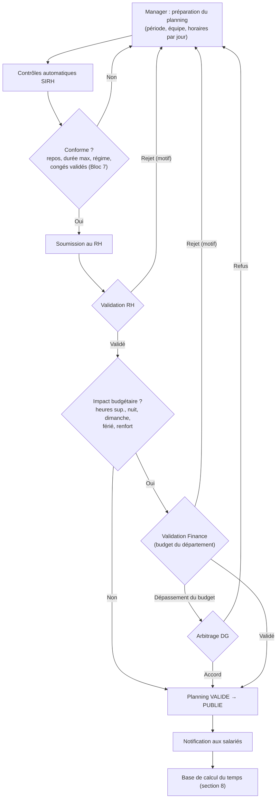
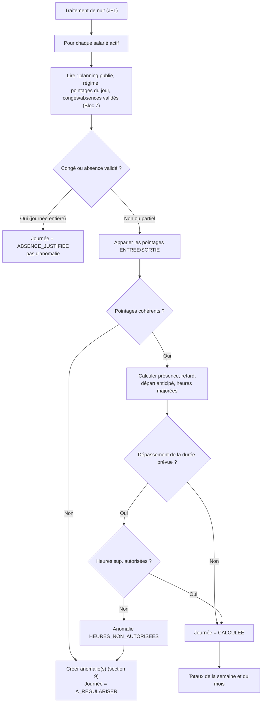
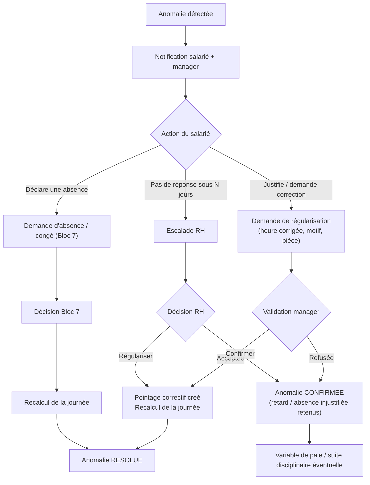
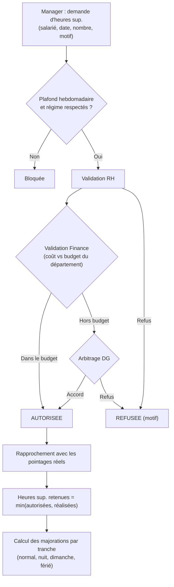
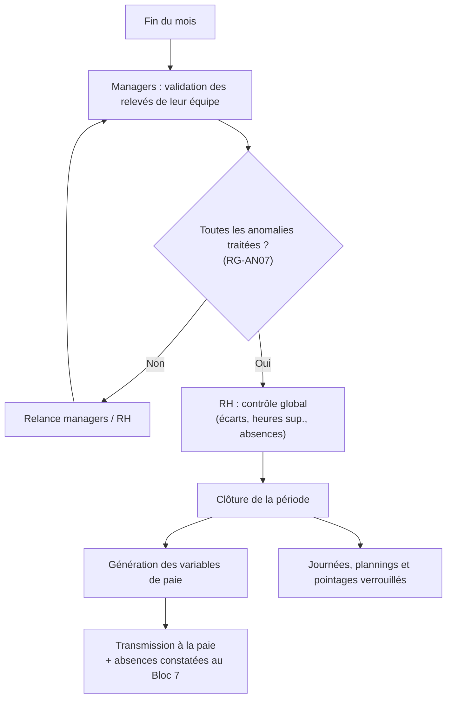
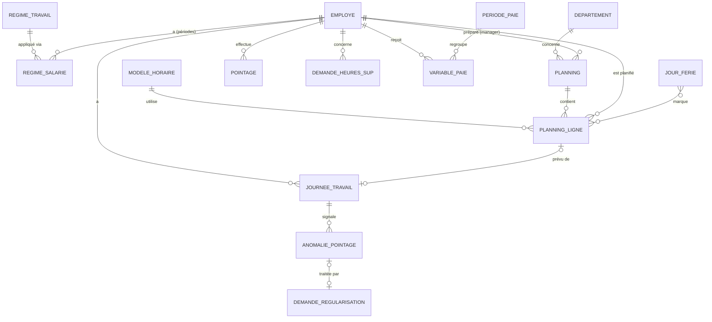

# BLOC 6 — TEMPS DE TRAVAIL ET POINTAGE
## Analyse métier, règles de gestion et workflows d'un SIRH

## 1. Objectif du bloc

Le Bloc 6 organise et mesure le temps de travail des salariés. Il doit permettre de :

1. **définir** quand le salarié doit travailler (régime, horaires, planning) ;
2. **enregistrer** quand il a réellement travaillé (pointages d'entrée et de sortie) ;
3. **comparer** les deux pour calculer le temps réellement travaillé, les retards, les absences
   non justifiées et les heures supplémentaires ;
4. **détecter** les anomalies de pointage et les faire régulariser ;
5. **transmettre** des données de temps validées au Bloc 7 (absences) et à la paie (variables).

> Principe central : **le temps prévu (planning) et le temps réalisé (pointage) sont deux
> données distinctes.** Le SIRH ne corrige jamais un pointage pour qu'il colle au planning ;
> il calcule l'écart et le fait valider.

---

# 2. Périmètre fonctionnel

Le Bloc 6 doit permettre de :

- paramétrer les régimes de travail (temps plein, temps partiel, travail posté, cadre au forfait…) ;
- paramétrer les modèles d'horaires (journée type, pauses, tolérances) ;
- faire préparer le planning par le manager et le faire valider par le RH, puis par la Finance
  s'il a un impact budgétaire ;
- enregistrer les pointages (badgeuse, saisie web, import, saisie manuelle par le RH) ;
- calculer chaque jour le temps travaillé, les retards, les départs anticipés et les heures supplémentaires ;
- détecter les anomalies et suivre leur régularisation ;
- clôturer la période (mois) et produire les variables de paie liées au temps.

### Répartition entre les blocs

| Bloc | Lien avec le Bloc 6 |
|---|---|
| Bloc 4 — Contrat et onboarding | Le contrat fixe la durée de travail contractuelle (temps plein / partiel). |
| Bloc 5 — Dossier administratif | Fournit le statut du salarié, son affectation (département, responsable, site) et son contrat en vigueur. |
| **Bloc 6 — Temps de travail** | **Planning, pointage, calcul du temps, anomalies, heures supplémentaires.** |
| Bloc 7 — Congés et absences | Reçoit les absences constatées ; renvoie les congés et absences validés pour qu'ils ne soient pas comptés comme anomalies. |
| Paie | Reçoit les variables de temps validées à la clôture de la période. |

---

# 3. Acteurs du processus

| Acteur | Responsabilités |
|---|---|
| Salarié | Pointe ses entrées et sorties, consulte son planning et son relevé d'heures, justifie ses anomalies. |
| Manager (responsable hiérarchique) | Prépare le planning de son équipe, demande les heures supplémentaires, valide les relevés et les régularisations de son équipe. |
| Responsable RH | Paramètre régimes et horaires, valide les plannings, traite les anomalies non résolues, clôture la période. |
| Finance | Valide les plannings et heures supplémentaires qui ont un impact budgétaire. |
| DG | Arbitre les dépassements de budget ou de plafond d'heures supplémentaires. |
| SIRH | Calcule, contrôle, détecte les anomalies, notifie et historise. |
| Dispositif de pointage | Badgeuse, terminal ou application qui envoie les pointages au SIRH. |

---

# 4. Cadre réglementaire de référence (Madagascar)

Les valeurs ci-dessous servent de **paramètres par défaut**. Elles doivent être vérifiées
dans le Code du travail (Loi n° 2003-044) et ses décrets d'application, ainsi que dans la
convention collective éventuelle, avant la mise en production.

| Paramètre | Valeur de référence à confirmer |
|---|---|
| Durée légale hebdomadaire (établissements non agricoles) | 40 heures |
| Durée mensuelle correspondante | 173,33 heures |
| Repos hebdomadaire | 24 heures consécutives minimum, en principe le dimanche |
| Majoration des heures supplémentaires | Taux par tranche (8 premières heures / au-delà), nuit, dimanche et jour férié — paramétrables |
| Plafond d'heures supplémentaires | Plafond hebdomadaire paramétrable ; dépassement interdit sans autorisation |
| Jours fériés | Calendrier officiel annuel, paramétré par le RH |

Aucun taux n'est codé en dur : tous sont stockés dans le paramétrage, avec une date d'effet.

---

# 5. Régimes de travail et horaires

## 5.1. Objet `RegimeTravail`

Définit le cadre général applicable à un salarié.

| Attribut | Description |
|---|---|
| `code`, `libelle` | Ex. TEMPS_PLEIN, TEMPS_PARTIEL_50, POSTE_3X8, CADRE_FORFAIT. |
| `duree_hebdo_heures` | Durée contractuelle hebdomadaire. |
| `jours_travailles` | Jours habituellement travaillés (lun → ven, lun → sam…). |
| `pointage_obligatoire` | Le salarié doit-il pointer ? (un cadre au forfait peut en être dispensé). |
| `heures_sup_autorisees` | Le régime ouvre-t-il droit aux heures supplémentaires ? |
| `date_effet`, `date_fin` | Période de validité du paramétrage. |

## 5.2. Objet `ModeleHoraire`

Décrit une journée type.

| Attribut | Description |
|---|---|
| `code`, `libelle` | Ex. JOUR_8H, MATIN_6H_14H, NUIT_22H_6H. |
| `heure_debut`, `heure_fin` | Plage de travail. |
| `pause_debut`, `pause_fin` ou `duree_pause_minutes` | Pause non rémunérée. |
| `tolerance_retard_minutes` | Retard toléré sans être compté (ex. 10 min). |
| `tolerance_depart_minutes` | Départ anticipé toléré. |
| `est_nuit` | Le créneau est-il du travail de nuit (majoration) ? |
| `duree_theorique_minutes` | Calculée : fin − début − pause. |

## 5.3. Rattachement au salarié

Le régime est rattaché au salarié **par période** (`RegimeSalarie` : salarié, régime, date
début, date fin), sur le même principe que les affectations du Bloc 5 : on clôt l'ancienne
période et on en ouvre une nouvelle, on n'écrase rien.

## 5.4. Règles de gestion — régimes et horaires

| Code | Règle |
|---|---|
| RG-RT01 | Tout salarié actif a un régime de travail en vigueur à chaque date. |
| RG-RT02 | La durée hebdomadaire du régime est cohérente avec le contrat en vigueur (temps plein / partiel). |
| RG-RT03 | La durée hebdomadaire d'un régime ne dépasse pas la durée légale, sauf régime d'équivalence paramétré et validé. |
| RG-RT04 | Un changement de régime est daté et ne modifie pas les journées déjà calculées. |
| RG-RT05 | Un modèle horaire a une heure de fin postérieure à l'heure de début, sauf horaire de nuit chevauchant minuit (signalé par `est_nuit`). |
| RG-RT06 | Un modèle horaire utilisé dans un planning validé ne peut plus être modifié ; on en crée une nouvelle version. |
| RG-RT07 | Les taux de majoration, plafonds et jours fériés sont paramétrés avec une date d'effet ; un calcul utilise toujours les paramètres en vigueur à la date travaillée. |

---

# 6. Planning

## 6.1. Principe

Le planning dit, pour chaque salarié et chaque jour d'une période (semaine ou mois) :
travaille-t-il, avec quel modèle horaire, ou est-il en repos ?

- **Le manager prépare** le planning de son équipe (son équipe = les salariés dont il est
  responsable dans une affectation active, Bloc 5).
- **Le RH valide** sa conformité (repos, durées, régimes).
- **La Finance valide** seulement si le planning a un **impact budgétaire** : heures
  supplémentaires planifiées, travail de nuit / dimanche / jour férié majoré, renfort
  d'effectif. Sans impact budgétaire, la Finance n'intervient pas.

## 6.2. Objets

- `Planning` : département ou équipe, période (début, fin), auteur, statut, coût estimé, version.
- `PlanningLigne` : planning, salarié, date, modèle horaire (ou REPOS / FERIE), heures prévues,
  heures majorées prévues.

## 6.3. Workflow du planning

## 6.4. États du planning

| État | Signification |
|---|---|
| `BROUILLON` | En préparation par le manager. |
| `SOUMIS_RH` | En attente de validation RH. |
| `SOUMIS_FINANCE` | Validé par le RH, en attente de la Finance (impact budgétaire). |
| `ARBITRAGE_DG` | Dépassement de budget soumis à la DG. |
| `REJETE` | Renvoyé au manager avec un motif. |
| `PUBLIE` | Validé et visible par les salariés ; sert de référence au calcul. |
| `MODIFIE` | Version remplacée par une version plus récente. |
| `CLOTURE` | Période clôturée (section 11) ; plus aucune modification. |

## 6.5. Modification d'un planning publié

Une modification après publication crée une **nouvelle version** qui repasse par les
validations nécessaires (RH, et Finance si la modification ajoute un impact budgétaire).
L'ancienne version passe `MODIFIE` et reste consultable.

## 6.6. Règles de gestion — planning

| Code | Règle |
|---|---|
| RG-PL01 | Un manager ne planifie que les salariés dont il est responsable dans une affectation active. |
| RG-PL02 | Un salarié n'a qu'une seule ligne de planning par jour (hors travail fractionné paramétré). |
| RG-PL03 | Le planning respecte le repos hebdomadaire minimal et la durée maximale de travail ; sinon il est bloqué avant soumission. |
| RG-PL04 | Un jour de congé ou d'absence validé (Bloc 7) ne peut pas être planifié en travail ; il apparaît automatiquement dans le planning. |
| RG-PL05 | Un jour férié est marqué `FERIE` ; le planifier en travail le rend « majoré » et donc à impact budgétaire. |
| RG-PL06 | Le SIRH calcule le coût estimé du planning (heures majorées × taux) et le compare au budget du département. |
| RG-PL07 | Un planning sans impact budgétaire est validé par le RH seul ; avec impact, il exige en plus la validation Finance. |
| RG-PL08 | Un dépassement du budget du département est arbitré par la DG. |
| RG-PL09 | Tout rejet est motivé et renvoie le planning au manager. |
| RG-PL10 | Le planning d'une période doit être publié avant le début de cette période ; un délai de prévenance minimal (paramétrable) est contrôlé. |
| RG-PL11 | Une modification après publication crée une nouvelle version ; l'ancienne est conservée. |
| RG-PL12 | Un planning ne peut plus être modifié après la clôture de la période. |

---

# 7. Pointage

## 7.1. Sources de pointage

| Source | Description | Fiabilité |
|---|---|---|
| Badgeuse / terminal | Pointage horodaté par l'appareil. | Haute |
| Application web | Le salarié pointe depuis le SIRH (contrôle d'adresse IP ou de site possible). | Moyenne |
| Import de fichier | Import du fichier d'une badgeuse non connectée. | Haute |
| Saisie manuelle | Saisie par le RH ou le manager (oubli, panne). | Faible : toujours justifiée et tracée |

## 7.2. Objet `Pointage`

| Attribut | Description |
|---|---|
| `id` | Identifiant. |
| `employe_id` | Salarié. |
| `horodatage` | Date et heure du pointage. |
| `sens` | ENTREE ou SORTIE (déduit si la badgeuse ne l'envoie pas). |
| `source` | BADGEUSE, WEB, IMPORT, MANUEL. |
| `terminal` / `site` | Lieu du pointage. |
| `saisi_par_id`, `motif` | Obligatoires pour une saisie manuelle. |
| `statut` | VALIDE, ANNULE (un pointage n'est jamais supprimé). |
| `pointage_corrige_id` | Pointage d'origine en cas de correction. |

## 7.3. Règles de gestion — pointage

| Code | Règle |
|---|---|
| RG-PT01 | Un pointage brut n'est jamais modifié ni supprimé ; une correction crée un nouveau pointage et annule l'ancien, avec motif et auteur. |
| RG-PT02 | Deux pointages identiques (même salarié, même sens, à moins de N minutes, paramétrable) sont fusionnés : le doublon est ignoré. |
| RG-PT03 | Un pointage manuel exige un motif et l'identité de son auteur ; il est signalé dans le relevé. |
| RG-PT04 | Un salarié ne peut pas saisir manuellement ses propres pointages : il en fait la demande (régularisation, section 9). |
| RG-PT05 | Un salarié `SORTI` ou `SUSPENDU` (Bloc 5) ne peut pas pointer ; une tentative est rejetée et journalisée. |
| RG-PT06 | Un pointage dans le futur ou sur une période clôturée est refusé. |
| RG-PT07 | Les salariés dont le régime ne prévoit pas de pointage sont exclus de la détection des anomalies de pointage. |

---

# 8. Calcul du temps réellement travaillé

## 8.1. La journée de travail

Chaque nuit, le SIRH construit pour chaque salarié une **journée de travail** (`JourneeTravail`)
qui rapproche le planning et les pointages.

| Donnée calculée | Calcul |
|---|---|
| Heures prévues | Durée du modèle horaire planifié (0 si repos). |
| Heures présentes | Somme des intervalles ENTREE → SORTIE, moins la pause. |
| Retard | Première entrée − heure de début planifiée, si > tolérance. |
| Départ anticipé | Heure de fin planifiée − dernière sortie, si > tolérance. |
| Heures travaillées retenues | Heures présentes, plafonnées aux heures prévues sauf heures supplémentaires autorisées. |
| Heures supplémentaires | Heures au-delà de la durée de référence, **uniquement si autorisées** (section 10). |
| Heures de nuit / dimanche / férié | Part des heures travaillées dans ces créneaux. |
| Absence | Heures prévues non couvertes et non justifiées par le Bloc 7. |

## 8.2. Workflow du calcul quotidien

## 8.3. États d'une journée

`A_CALCULER`, `CALCULEE`, `A_REGULARISER`, `ABSENCE_JUSTIFIEE`, `VALIDEE` (par le manager),
`CLOTUREE` (période close).

## 8.4. Règles de gestion — calcul du temps

| Code | Règle |
|---|---|
| RG-TT01 | Le temps travaillé est calculé à partir des pointages valides, jamais recopié depuis le planning. |
| RG-TT02 | La pause prévue par le modèle horaire est déduite, sauf si des pointages de pause existent (on retient alors la pause réelle, au minimum la pause légale). |
| RG-TT03 | Un retard ou un départ anticipé inférieur à la tolérance n'est pas compté. Au-delà, il est compté en entier (pas seulement l'excédent). |
| RG-TT04 | Une présence au-delà de l'horaire prévu sans autorisation d'heures supplémentaires n'est pas payée en heures supplémentaires ; elle génère une anomalie. |
| RG-TT05 | Un horaire de nuit chevauchant minuit est rattaché au jour de début de la prise de poste. |
| RG-TT06 | Un jour de congé ou d'absence validé dans le Bloc 7 n'est jamais compté comme absence injustifiée. |
| RG-TT07 | Un recalcul est possible tant que la période n'est pas clôturée (correction de pointage, planning ou congé tardif) ; chaque recalcul est tracé. |
| RG-TT08 | Les totaux hebdomadaires servent au calcul des heures supplémentaires ; les totaux mensuels servent à la paie. |
| RG-TT09 | Le salarié consulte son relevé quotidien et mensuel ; le manager valide les relevés de son équipe. |

---

# 9. Anomalies de pointage

## 9.1. Types d'anomalies

| Code | Anomalie | Exemple |
|---|---|---|
| `POINTAGE_MANQUANT_ENTREE` | Sortie sans entrée. | Le salarié a oublié de badger le matin. |
| `POINTAGE_MANQUANT_SORTIE` | Entrée sans sortie. | Oubli de badger le soir. |
| `ABSENCE_NON_JUSTIFIEE` | Jour planifié sans aucun pointage ni absence validée. | — |
| `RETARD` | Arrivée après la tolérance. | Arrivée à 8 h 25 pour 8 h, tolérance 10 min. |
| `DEPART_ANTICIPE` | Départ avant la fin, au-delà de la tolérance. | — |
| `HEURES_NON_AUTORISEES` | Présence au-delà de l'horaire sans heures sup. autorisées. | — |
| `POINTAGE_HORS_PLANNING` | Pointage un jour de repos ou de congé. | — |
| `PAUSE_INSUFFISANTE` | Pause réelle inférieure à la pause minimale. | — |
| `POINTAGE_INCOHERENT` | Séquence impossible (deux entrées de suite, durée > 24 h). | — |

## 9.2. Workflow de régularisation

États d'une anomalie : `OUVERTE`, `EN_COURS` (demande déposée), `RESOLUE`, `CONFIRMEE`, `CLASSEE` (sans suite, par le RH).

## 9.3. Règles de gestion — anomalies

| Code | Règle |
|---|---|
| RG-AN01 | Chaque anomalie est rattachée à un salarié, une journée et un type. |
| RG-AN02 | Une anomalie ouverte bloque la validation de la journée par le manager. |
| RG-AN03 | Le salarié est notifié de toute anomalie le concernant et peut la justifier dans un délai paramétrable (par défaut 3 jours ouvrés). |
| RG-AN04 | Sans réponse dans le délai, l'anomalie est escaladée au RH. |
| RG-AN05 | Une régularisation acceptée crée un pointage correctif ; elle ne modifie pas le pointage d'origine (RG-PT01). |
| RG-AN06 | Une absence non justifiée confirmée est transmise au Bloc 7 comme absence de type « absence injustifiée » et à la paie comme retenue potentielle. |
| RG-AN07 | Toutes les anomalies d'une période doivent être `RESOLUE`, `CONFIRMEE` ou `CLASSEE` avant la clôture de cette période. |
| RG-AN08 | Un classement sans suite par le RH est motivé. |
| RG-AN09 | Les retards répétés (seuil paramétrable sur le mois) sont signalés au manager et au RH ; la décision disciplinaire reste humaine. |

---

# 10. Heures supplémentaires

## 10.1. Principe

Une heure supplémentaire est une heure travaillée au-delà de la durée de référence
(hebdomadaire légale ou contractuelle) **et autorisée**. Elle peut être :

- **planifiée** : inscrite au planning et validée avec lui (Finance si budget) ;
- **demandée a posteriori** : le manager déclare un besoin ponctuel, à valider avant la clôture.

## 10.2. Workflow d'une demande d'heures supplémentaires

## 10.3. Règles de gestion — heures supplémentaires

| Code | Règle |
|---|---|
| RG-HS01 | Une heure supplémentaire n'est payée que si elle est autorisée **et** réalisée (pointée). |
| RG-HS02 | Le nombre d'heures supplémentaires retenu est le minimum entre les heures autorisées et les heures réellement réalisées. |
| RG-HS03 | Les heures supplémentaires sont décomptées sur la semaine, au-delà de la durée de référence. |
| RG-HS04 | Le plafond hebdomadaire et annuel d'heures supplémentaires est contrôlé ; tout dépassement est bloqué sauf autorisation tracée. |
| RG-HS05 | Les majorations sont calculées par tranche et par nature (jour, nuit, dimanche, férié) avec les taux en vigueur à la date travaillée. |
| RG-HS06 | Toute heure supplémentaire a un impact budgétaire et passe donc par la Finance ; au-delà du budget, par la DG. |
| RG-HS07 | Un salarié dont le régime n'ouvre pas droit aux heures supplémentaires (ex. cadre au forfait) ne peut pas en recevoir. |
| RG-HS08 | Une demande a posteriori doit être faite avant la clôture de la période. |

---

# 11. Clôture de la période et variables de paie

## 11.1. Workflow de clôture mensuelle

## 11.2. Variables produites

| Variable | Contenu |
|---|---|
| Heures normales travaillées | Total du mois. |
| Heures supplémentaires par tranche et par taux | Ex. HS 1re tranche, HS 2e tranche, nuit, dimanche, férié. |
| Absences injustifiées | Nombre d'heures ou de jours, pour retenue éventuelle. |
| Retards cumulés | Pour information ou retenue selon la politique. |
| Jours travaillés | Base de certaines primes (panier, transport). |

Objet `VariablePaie` (commun avec le Bloc 7) : salarié, période, code variable, quantité,
unité (heure / jour), source (BLOC6 / BLOC7), statut (CALCULEE, VALIDEE, TRANSMISE).

## 11.3. Règles de gestion — clôture et paie

| Code | Règle |
|---|---|
| RG-VP01 | Une période n'est clôturée que si tous les relevés sont validés et toutes les anomalies traitées. |
| RG-VP02 | La clôture verrouille pointages, journées et plannings de la période. |
| RG-VP03 | Les variables de paie ne sont générées qu'à partir de données validées. |
| RG-VP04 | Une correction après clôture se fait par une régularisation sur la période suivante, jamais en modifiant la période close. |
| RG-VP05 | La réouverture d'une période est exceptionnelle, réservée au RH, motivée et tracée. |
| RG-VP06 | Chaque variable transmise garde le lien vers les journées qui l'ont produite (traçabilité). |

---

# 12. Notifications et événements

| Événement | Destinataire | Action du SIRH |
|---|---|---|
| Planning soumis | RH | Demande de validation. |
| Planning avec impact budgétaire validé par le RH | Finance | Demande de validation. |
| Dépassement de budget | DG | Demande d'arbitrage. |
| Planning rejeté | Manager | Motif du rejet. |
| Planning publié ou modifié | Salariés concernés | Information. |
| Anomalie détectée | Salarié + manager | Demande de justification. |
| Anomalie non traitée dans le délai | RH | Escalade. |
| Demande d'heures sup. | RH → Finance → DG | Circuit de validation. |
| Retards répétés | Manager + RH | Signalement. |
| Clôture proche avec anomalies ouvertes | Managers + RH | Relance. |
| Période clôturée | Paie, Bloc 7 | Transmission des variables et absences. |

---

# 13. Cas particuliers

1. **Panne de badgeuse :** le RH déclare l'incident ; les pointages de la plage concernée sont saisis manuellement avec le motif « panne » (RG-PT03).
2. **Mission ou déplacement :** journée déclarée « en mission » par le manager ; pas d'anomalie de pointage.
3. **Télétravail :** pointage web autorisé ou journée forfaitaire selon la politique.
4. **Travail de nuit chevauchant minuit :** rattaché au jour de prise de poste (RG-TT05).
5. **Jour férié travaillé :** majoration férié ; planning à impact budgétaire.
6. **Changement d'affectation en cours de mois (Bloc 5) :** le planning du nouveau département s'applique à partir de la date d'effet ; le nouveau manager reprend la validation.
7. **Congé validé après coup (Bloc 7) :** recalcul des journées concernées, annulation des anomalies correspondantes.
8. **Salarié embauché ou sorti en cours de mois :** calcul limité aux jours de présence contractuelle.
9. **Erreur après clôture :** régularisation sur la période suivante (RG-VP04).
10. **Changement d'heure / horaires saisonniers :** gérés par une nouvelle version de modèle horaire avec date d'effet.

---

# 14. Modèle conceptuel

Tous ces objets sont **à créer** : le projet ne contient encore aucune table de planning,
de pointage ou de temps. Le Bloc 6 réutilise `employe`, `affectation` (pour connaître le
manager et le département), `departement` et `budget_departement` (contrôle budgétaire du
planning).

---

# 15. Interfaces principales

- **Salarié :** bouton « Pointer » (entrée / sortie), mon planning, mon relevé du jour et du mois, mes anomalies avec bouton « Justifier ».
- **Manager :** éditeur de planning (grille salariés × jours), file des anomalies de l'équipe, demandes d'heures sup., validation des relevés mensuels.
- **RH :** paramétrage (régimes, modèles horaires, jours fériés, taux), validation des plannings, tableau des anomalies escaladées, clôture de période.
- **Finance :** file des plannings et heures sup. à impact budgétaire, avec coût estimé et budget restant du département.

---

# 16. MVP recommandé

## Fonctionnalités indispensables

- Régimes et modèles horaires paramétrables.
- Planning préparé par le manager, validé par le RH, et par la Finance si impact budgétaire.
- Pointage web entrée / sortie.
- Calcul quotidien : présence, retard, départ anticipé.
- Détection des anomalies principales (entrée/sortie manquante, absence non justifiée, retard).
- Régularisation par le manager.
- Clôture mensuelle et export des variables de paie.

## Fonctionnalités pouvant être ajoutées ultérieurement

- Connexion à une badgeuse physique / import de fichiers.
- Heures supplémentaires avec majorations par tranche complètes.
- Travail posté et horaires de nuit chevauchant minuit.
- Simulation du coût du planning en temps réel.
- Contrôle de site / géolocalisation du pointage web.

---

# 17. Indicateurs de suivi

- Taux de présence et taux d'absentéisme injustifié.
- Nombre moyen de retards par salarié et par département.
- Heures supplémentaires réalisées vs autorisées vs budget.
- Nombre d'anomalies par type et délai moyen de régularisation.
- Taux de plannings publiés dans les délais.

---

# 18. Conditions de sortie du Bloc 6

Le Bloc 6 est opérationnel lorsque :

- chaque salarié actif a un régime et un planning publié pour la période ;
- les pointages sont enregistrés et jamais modifiés silencieusement ;
- le temps réellement travaillé est calculé chaque jour à partir des pointages ;
- les anomalies sont détectées, notifiées et traitées avant la clôture ;
- les heures supplémentaires ne sont retenues que si elles sont autorisées et réalisées ;
- les variables de paie et les absences constatées sont transmises à la paie et au Bloc 7.

---

# 19. Points de conception à retenir

1. **Prévu ≠ réalisé** : planning et pointage sont deux données distinctes, comparées mais jamais fusionnées.
2. **Un pointage ne se modifie pas** : on l'annule et on en crée un correctif tracé.
3. **Le manager planifie, le RH valide, la Finance valide seulement s'il y a un coût** supplémentaire.
4. **Heure supplémentaire = autorisée ET réalisée.**
5. **Une anomalie se régularise** avant la clôture ; elle ne disparaît pas toute seule.
6. **Le Bloc 7 est prioritaire sur l'anomalie** : un congé validé n'est jamais une absence injustifiée.
7. **Une période clôturée ne bouge plus** : les corrections passent sur la période suivante.
8. **Tous les taux et durées sont paramétrés avec une date d'effet**, à vérifier dans le Code du travail (Loi n° 2003-044).
