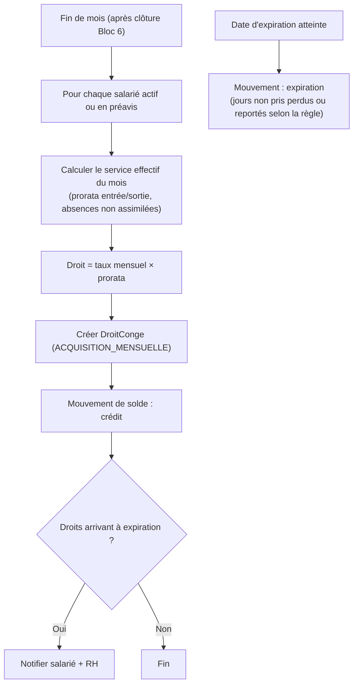
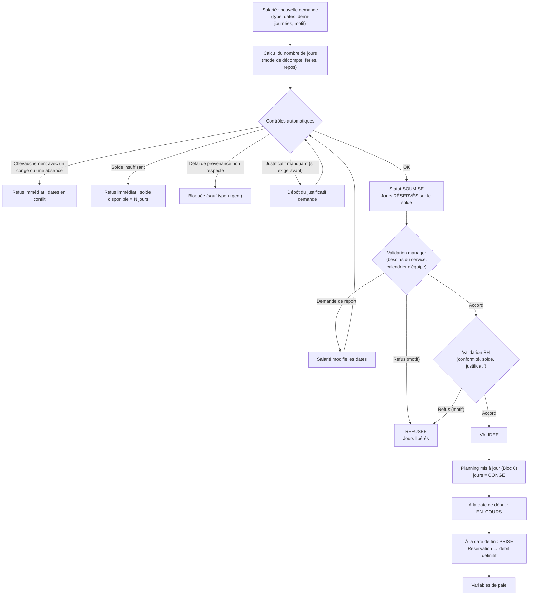
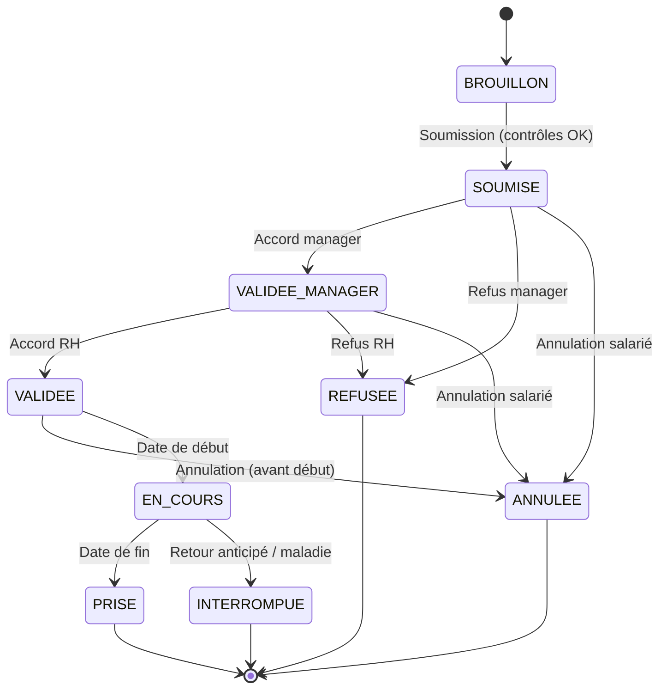
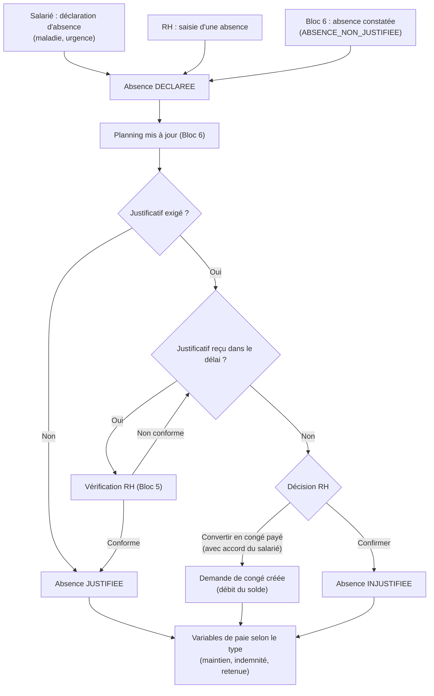
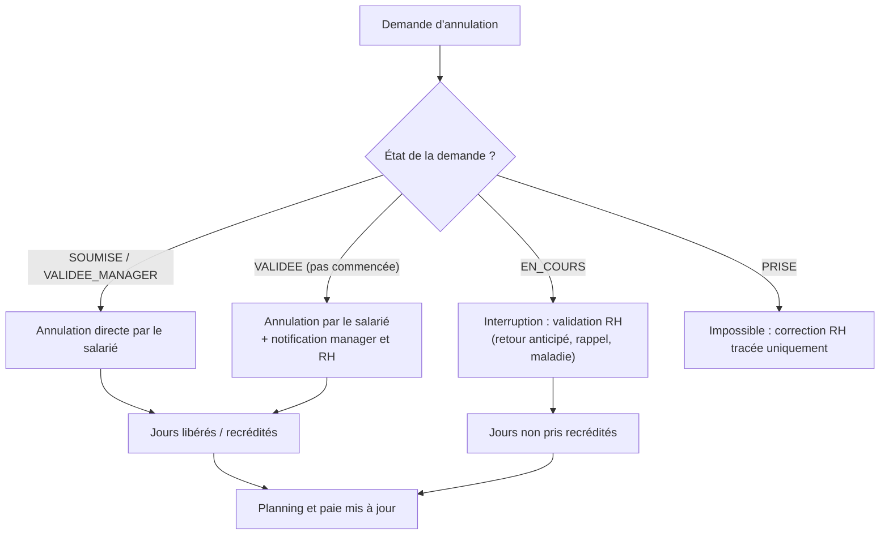
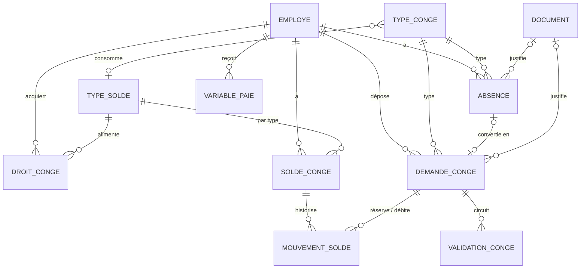

# BLOC 7 — CONGÉS ET ABSENCES
## Analyse métier, règles de gestion et workflows d'un SIRH

## 1. Objectif du bloc

Le Bloc 7 gère tout ce qui fait qu'un salarié **ne travaille pas** un jour où il était
prévu au travail : congés payés, permissions, congés spéciaux, maladie, absences
justifiées ou non.

Il doit permettre de :

1. **acquérir** des droits à congé selon des règles paramétrées ;
2. **tenir** un solde fiable, mis à jour à chaque acquisition, prise ou correction ;
3. **demander** un congé, contrôler le solde et les chevauchements, puis le faire valider
   par le manager et le RH ;
4. **enregistrer** les absences et leurs justificatifs ;
5. **mettre à jour** le planning (Bloc 6) et les variables de paie.

Le parcours principal est :

```
Demande de congé → contrôle du solde → validation manager → validation RH → planning + paie
```

---

# 2. Périmètre fonctionnel

Le Bloc 7 doit permettre de :

- paramétrer les types de congés et d'absences (`TypeConge`) ;
- calculer et attribuer les droits (`DroitConge`) ;
- tenir les soldes par salarié, type et période (`SoldeConge`) ;
- gérer les demandes de congé (`DemandeConge`) et leur circuit de validation ;
- enregistrer les absences (`Absence`), justifiées ou non, déclarées ou constatées par le Bloc 6 ;
- gérer les justificatifs (certificat médical, acte d'état civil…) ;
- contrôler les chevauchements et la disponibilité du solde ;
- annuler ou modifier un congé selon des règles précises ;
- mettre à jour le planning et produire les variables de paie.

### Répartition entre les blocs

| Bloc | Lien avec le Bloc 7 |
|---|---|
| Bloc 4 — Contrat | La date d'effet du contrat ouvre l'acquisition des droits. |
| Bloc 5 — Dossier administratif | Fournit le statut, l'ancienneté, le contrat en vigueur, les enfants à charge et le manager (affectation active). Reçoit les justificatifs comme documents du dossier. |
| Bloc 6 — Temps de travail | Fournit les jours planifiés et les absences constatées (absence injustifiée). Reçoit les congés et absences validés pour mettre à jour le planning et ne pas créer d'anomalie. |
| **Bloc 7 — Congés et absences** | **Droits, soldes, demandes, validations, absences, justificatifs.** |
| Paie | Reçoit les variables : congés payés pris, absences non rémunérées, indemnités. |

---

# 3. Acteurs du processus

| Acteur | Responsabilités |
|---|---|
| Salarié | Consulte ses soldes, dépose une demande de congé, déclare une absence, fournit les justificatifs, annule une demande non encore prise. |
| Manager | Valide ou refuse les demandes de son équipe au regard des besoins du service ; voit le calendrier de l'équipe. |
| Responsable RH | Paramètre types et règles, valide la conformité (solde, droit, justificatif), saisit les absences, corrige les soldes, clôture la période. |
| DG | Valide les congés du personnel qui lui est directement rattaché et les congés exceptionnels hors règles. |
| SIRH | Calcule droits et soldes, contrôle les demandes, détecte les chevauchements, met à jour le planning, produit les variables de paie, notifie. |

---

# 4. Cadre réglementaire de référence (Madagascar)

Valeurs par défaut, **à vérifier** dans le Code du travail (Loi n° 2003-044), ses décrets
d'application et la convention collective éventuelle avant la mise en production. Toutes sont
paramétrées avec une date d'effet.

| Paramètre | Valeur de référence à confirmer |
|---|---|
| Acquisition des congés payés | 2,5 jours calendaires par mois de service effectif (30 jours par an) |
| Mode de décompte | Jours calendaires (paramétrable : calendaires / ouvrables / ouvrés) |
| Permissions exceptionnelles pour événements familiaux | Nombre de jours par an non déduits du congé payé, selon l'événement |
| Congé de maternité | Durée légale paramétrée (en semaines), avec justificatif médical |
| Congé de paternité | Durée légale paramétrée (en jours) |
| Maladie | Absence justifiée par certificat médical ; régime d'indemnisation à paramétrer (employeur / organisme de santé) |
| Report et prescription des congés non pris | Règle à paramétrer (durée de report, plafond de cumul) |

---

# 5. Types de congés et d'absences

## 5.1. Objet `TypeConge`

| Attribut | Description |
|---|---|
| `code`, `libelle` | Ex. CONGE_PAYE, PERMISSION, MATERNITE, PATERNITE, MALADIE, SANS_SOLDE, ABSENCE_INJUSTIFIEE. |
| `categorie` | CONGE (demandé à l'avance) ou ABSENCE (déclarée ou constatée). |
| `decompte_solde` | Le type consomme-t-il un solde ? |
| `type_solde_id` | Solde consommé (ex. une permission consomme le solde « permissions », pas le congé payé). |
| `remunere` | Payé, non payé ou indemnisé par un organisme. |
| `unite` | Jour ou demi-journée (ou heure pour les absences courtes). |
| `mode_decompte` | CALENDAIRE, OUVRABLE, OUVRE. |
| `justificatif_obligatoire` | Et type de document attendu (Bloc 5). |
| `delai_justificatif_jours` | Délai pour fournir la pièce. |
| `delai_prevenance_jours` | Délai minimal entre la demande et le début du congé. |
| `duree_max_jours` | Durée maximale par demande ou par événement. |
| `validation_manager`, `validation_rh` | Circuit de validation requis. |
| `acquis_pendant` | La période d'absence compte-t-elle comme service effectif pour l'acquisition des congés ? |
| `actif`, `date_effet` | Paramétrage versionné. |

## 5.2. Types proposés

| Type | Catégorie | Solde | Rémunéré | Justificatif | Validation |
|---|---|---|---|---|---|
| Congé payé | CONGE | Congés payés | Oui | Non | Manager + RH |
| Permission exceptionnelle (mariage, naissance, décès…) | CONGE | Permissions | Oui | Oui (acte) | Manager + RH |
| Congé de maternité | CONGE | Aucun | Selon régime | Oui (certificat médical) | RH |
| Congé de paternité | CONGE | Aucun | Selon régime | Oui (acte de naissance) | Manager + RH |
| Congé sans solde | CONGE | Aucun | Non | Non | Manager + RH (+ DG au-delà d'une durée) |
| Maladie | ABSENCE | Aucun | Selon régime | Oui (certificat médical) | RH |
| Accident du travail | ABSENCE | Aucun | Selon régime | Oui (déclaration) | RH |
| Absence autorisée non payée | ABSENCE | Aucun | Non | Selon cas | Manager |
| Absence injustifiée | ABSENCE | Aucun | Non | — | Constatée (Bloc 6) |
| Récupération | CONGE | Repos compensateur | Oui | Non | Manager |

## 5.3. Règles de gestion — types

| Code | Règle |
|---|---|
| RG-TC01 | Chaque congé ou absence est rattaché à un type paramétré ; aucun libre texte. |
| RG-TC02 | Un type qui consomme un solde référence exactement un type de solde. |
| RG-TC03 | Un type dont le justificatif est obligatoire ne peut pas être validé définitivement sans la pièce vérifiée (Bloc 5). |
| RG-TC04 | Un type désactivé n'est plus proposé pour de nouvelles demandes, mais reste lisible dans l'historique. |
| RG-TC05 | Le mode de décompte (calendaire, ouvrable, ouvré) est porté par le type et appliqué de façon identique au calcul de durée et au débit du solde. |

---

# 6. Droits et soldes

## 6.1. Objet `DroitConge`

Un droit est une **ligne d'acquisition** : il dit combien de jours le salarié acquiert,
pour quel type de solde, au titre de quelle période.

| Attribut | Description |
|---|---|
| `employe_id`, `type_solde` | Salarié et solde concernés. |
| `periode_reference` | Période d'acquisition (ex. mois 2026-11). |
| `jours_acquis` | Ex. 2,5. |
| `origine` | ACQUISITION_MENSUELLE, ANCIENNETE, ATTRIBUTION_ANNUELLE (permissions), REPORT, AJUSTEMENT. |
| `date_acquisition`, `date_expiration` | Validité du droit (report / prescription). |
| `auteur_id`, `motif` | Obligatoires pour un ajustement manuel. |

## 6.2. Objet `SoldeConge`

Le solde est **calculé** à partir des mouvements ; il n'est jamais saisi directement.

```
Solde disponible = Σ droits acquis non expirés
                 − Σ jours pris (congés validés passés)
                 − Σ jours réservés (congés validés à venir + demandes en cours)
```

| Donnée | Description |
|---|---|
| `acquis` | Total des droits acquis non expirés. |
| `pris` | Jours consommés par des congés effectués. |
| `reserve` | Jours bloqués par des demandes en cours ou des congés validés futurs. |
| `disponible` | Acquis − pris − réservé. |
| `a_expirer` | Jours qui vont expirer prochainement (alerte). |

Chaque variation est enregistrée comme **mouvement de solde** (crédit / débit / réservation /
libération / expiration / ajustement), ce qui rend le solde reconstituable à toute date.

## 6.3. Workflow d'acquisition mensuelle



## 6.4. Règles de gestion — droits et soldes

| Code | Règle |
|---|---|
| RG-SC01 | Les droits s'acquièrent à partir de la date d'effet du premier contrat (Bloc 4), au prorata du service effectif. |
| RG-SC02 | Une absence dont le type n'est pas « assimilée à du service effectif » réduit l'acquisition du mois au prorata. |
| RG-SC03 | Le solde est toujours calculé à partir des mouvements ; il n'est jamais modifié directement. |
| RG-SC04 | Un ajustement manuel du solde est réservé au RH, motivé et tracé comme mouvement `AJUSTEMENT`. |
| RG-SC05 | Les jours d'une demande en cours de validation sont **réservés** : ils ne sont plus disponibles pour une autre demande. |
| RG-SC06 | Un refus ou une annulation libère immédiatement les jours réservés. |
| RG-SC07 | Les congés payés consomment d'abord les droits les plus anciens (premier acquis, premier consommé). |
| RG-SC08 | Les droits non pris expirent ou sont reportés selon la règle paramétrée ; le salarié est prévenu avant l'expiration. |
| RG-SC09 | Le solde peut être négatif uniquement si le type l'autorise explicitement (anticipation de congé) et dans une limite paramétrée validée par le RH. |
| RG-SC10 | À la sortie du salarié (Bloc 5), le solde disponible est figé et transmis à la paie pour l'indemnité compensatrice de congés non pris. |
| RG-SC11 | Les permissions exceptionnelles ont un solde annuel distinct, remis à zéro chaque année ; elles ne sont jamais déduites du congé payé. |

---

# 7. Demande de congé

## 7.1. Objet `DemandeConge`

| Attribut | Description |
|---|---|
| `id`, `reference` | Identifiant. |
| `employe_id` | Demandeur (ou salarié pour lequel le RH saisit). |
| `type_conge_id` | Type demandé. |
| `date_debut`, `demi_journee_debut` | Début (matin / après-midi). |
| `date_fin`, `demi_journee_fin` | Fin. |
| `nb_jours` | Calculé selon le mode de décompte, hors jours fériés et repos si applicable. |
| `motif` | Facultatif, obligatoire pour certains types. |
| `justificatif_id` | Document déposé (Bloc 5). |
| `statut` | Voir section 7.3. |
| `valide_manager_par_id`, `date_validation_manager`, `commentaire_manager` | Trace. |
| `valide_rh_par_id`, `date_validation_rh`, `commentaire_rh` | Trace. |
| `interimaire_id` | Remplaçant éventuel désigné. |
| `date_creation` | Date de la demande. |

## 7.2. Workflow principal



Si le salarié n'a pas de manager (ou si le manager est le DG), la validation manager est
remplacée par la DG. Si le manager est absent, la demande est redirigée vers son
remplaçant désigné ou vers le RH après un délai paramétrable.

## 7.3. États d'une demande

| État | Signification |
|---|---|
| `BROUILLON` | En cours de saisie, pas encore soumise. |
| `SOUMISE` | En attente du manager ; jours réservés. |
| `VALIDEE_MANAGER` | Accord du manager, en attente du RH. |
| `VALIDEE` | Validation finale ; planning mis à jour. |
| `REFUSEE` | Refusée par le manager ou le RH, avec motif ; jours libérés. |
| `ANNULEE` | Annulée par le salarié ou le RH avant la prise ; jours libérés. |
| `EN_COURS` | Congé en cours. |
| `PRISE` | Congé terminé ; jours définitivement débités. |
| `INTERROMPUE` | Congé écourté (rappel, maladie pendant le congé) ; jours non pris recrédités. |



## 7.4. Règles de gestion — demande et validation

| Code | Règle |
|---|---|
| RG-DC01 | Une demande porte sur un seul type de congé et une période continue. |
| RG-DC02 | La date de fin est postérieure ou égale à la date de début ; une demi-journée de fin ne peut pas précéder celle de début le même jour. |
| RG-DC03 | Le nombre de jours est calculé par le SIRH selon le mode de décompte du type ; le salarié ne le saisit pas. |
| RG-DC04 | Les jours fériés et les jours de repos ne sont pas décomptés lorsque le mode de décompte l'exclut. |
| RG-DC05 | Une demande ne peut pas être soumise si le solde disponible est insuffisant (sauf RG-SC09). |
| RG-DC06 | Le délai de prévenance du type est contrôlé ; les types urgents (maladie, décès) en sont exemptés. |
| RG-DC07 | Un salarié `SORTI` ou dont le contrat se termine avant la fin du congé ne peut pas déposer de demande dépassant la date de fin de contrat. |
| RG-DC08 | Le manager qui valide est le responsable de l'affectation active du salarié à la date de la demande (Bloc 5). |
| RG-DC09 | Un salarié ne peut pas valider sa propre demande, même s'il a le rôle manager ou RH. |
| RG-DC10 | La validation finale est toujours faite par le RH après celle du manager, sauf types paramétrés « RH seul » (maternité, maladie). |
| RG-DC11 | Tout refus est motivé ; le motif est visible par le salarié. |
| RG-DC12 | Une demande sans réponse du manager dans le délai paramétrable est escaladée au RH. |
| RG-DC13 | Le manager voit le calendrier d'équipe et un avertissement si le nombre d'absents simultanés dépasse le seuil du service ; la décision reste humaine. |
| RG-DC14 | Chaque changement d'état est horodaté avec son auteur. |

---

# 8. Contrôle des chevauchements

## 8.1. Ce qui est contrôlé

| Conflit | Comportement |
|---|---|
| Deux demandes de congé du même salarié sur des jours communs | Bloqué. |
| Congé et absence enregistrée (maladie…) sur des jours communs | Bloqué ; le RH tranche (voir cas « maladie pendant le congé »). |
| Congé sur un jour déjà pointé comme travaillé (Bloc 6) | Bloqué pour une demande a posteriori ; signalé au RH. |
| Congé sur un jour férié | Autorisé ; le jour férié n'est pas décompté (RG-DC04). |
| Congé chevauchant une date de fin de contrat | Bloqué (RG-DC07). |
| Plusieurs salariés du même service sur la même période | Non bloquant ; avertissement au manager (RG-DC13). |

## 8.2. Règles de gestion — chevauchements

| Code | Règle |
|---|---|
| RG-CH01 | Un salarié ne peut pas avoir deux congés ou absences actifs (`SOUMISE`, `VALIDEE_MANAGER`, `VALIDEE`, `EN_COURS`, `PRISE`) sur une même demi-journée. |
| RG-CH02 | Le contrôle se fait à la demi-journée près. |
| RG-CH03 | Les demandes `REFUSEE` et `ANNULEE` ne comptent pas dans le contrôle. |
| RG-CH04 | Le contrôle est refait au moment de chaque validation (une absence a pu être saisie entre-temps). |
| RG-CH05 | Le contrôle de chevauchement est garanti au niveau de la base de données (contrainte ou verrou), pas seulement dans l'interface, pour éviter deux demandes simultanées. |

---

# 9. Absences

## 9.1. Objet `Absence`

Une absence est un jour (ou une partie de jour) non travaillé qui n'a pas forcément fait
l'objet d'une demande préalable.

| Attribut | Description |
|---|---|
| `employe_id`, `type_conge_id` | Salarié et type (catégorie ABSENCE). |
| `date_debut`, `date_fin`, demi-journées ou `nb_heures` | Période. |
| `origine` | DECLAREE_SALARIE, SAISIE_RH, CONSTATEE_POINTAGE (Bloc 6). |
| `justifiee` | Oui / non. |
| `justificatif_id`, `date_limite_justificatif` | Pièce attendue et délai. |
| `statut` | Voir 9.3. |
| `demande_conge_id` | Lien éventuel si l'absence est convertie en congé. |

## 9.2. Workflow d'une absence



## 9.3. États d'une absence

`DECLAREE`, `EN_ATTENTE_JUSTIFICATIF`, `JUSTIFIEE`, `INJUSTIFIEE`, `CONVERTIE` (en congé), `ANNULEE`.

## 9.4. Règles de gestion — absences

| Code | Règle |
|---|---|
| RG-AB01 | Toute absence est rattachée à un salarié, un type et une période. |
| RG-AB02 | Une absence pour maladie exige un certificat médical dans le délai paramétré (par défaut 48 h). |
| RG-AB03 | Sans justificatif dans le délai, l'absence passe `EN_ATTENTE_JUSTIFICATIF` puis est soumise à la décision du RH. |
| RG-AB04 | Une absence constatée par le Bloc 6 est créée `DECLAREE` avec l'origine `CONSTATEE_POINTAGE` ; le salarié est invité à la justifier. |
| RG-AB05 | Une absence injustifiée n'est jamais déduite automatiquement du solde de congés payés ; une conversion en congé exige l'accord du salarié. |
| RG-AB06 | Les justificatifs sont stockés comme documents du dossier salarié (Bloc 5), avec un niveau de confidentialité élevé pour les pièces médicales. |
| RG-AB07 | Le motif médical détaillé n'est visible que par le RH ; le manager voit seulement « absent – justifié » ou « absent – non justifié ». |
| RG-AB08 | Une absence longue (seuil paramétrable) déclenche le passage du salarié au statut `SUSPENDU` (Bloc 5), sur décision du RH. |
| RG-AB09 | Une absence validée met à jour le planning et annule les anomalies de pointage correspondantes (Bloc 6). |

---

# 10. Annulation, modification et interruption

## 10.1. Workflow d'annulation



## 10.2. Règles de gestion — annulation et modification

| Code | Règle |
|---|---|
| RG-MO01 | Une demande non commencée peut être annulée par le salarié ; les jours réservés sont libérés. |
| RG-MO02 | Une modification de dates d'une demande validée équivaut à une annulation suivie d'une nouvelle demande, qui repasse par le circuit complet. |
| RG-MO03 | Un congé en cours ne peut être interrompu que sur décision du RH (retour anticipé, rappel pour nécessité de service, maladie) ; les jours non pris sont recrédités. |
| RG-MO04 | Une maladie justifiée survenant pendant un congé payé interrompt le congé à partir de la date du certificat ; les jours concernés sont recrédités (règle à confirmer avec le droit applicable). |
| RG-MO05 | Un congé `PRISE` ne s'annule pas : une erreur se corrige par un ajustement de solde tracé (RG-SC04). |
| RG-MO06 | Le rappel d'un salarié en congé par l'employeur est motivé et tracé ; les frais et jours non pris sont gérés selon la politique. |

---

# 11. Impact sur le planning et la paie

## 11.1. Planning (Bloc 6)

| Événement du Bloc 7 | Effet sur le planning |
|---|---|
| Demande validée | Jours marqués `CONGE` (avec le type) ; impossibles à planifier en travail. |
| Annulation / interruption | Jours remis à l'état planifié initial (ou `A_PLANIFIER` si le planning a été modifié entre-temps). |
| Absence enregistrée | Jours marqués `ABSENCE` ; anomalies de pointage annulées. |

## 11.2. Variables de paie

Produites à la clôture de la période, dans l'objet `VariablePaie` commun avec le Bloc 6.

| Variable | Contenu |
|---|---|
| Congés payés pris | Nombre de jours (base de l'indemnité de congé). |
| Permissions exceptionnelles | Jours rémunérés. |
| Absences non rémunérées | Jours ou heures à retenir (sans solde, injustifiée, absence autorisée non payée). |
| Maladie / maternité / accident du travail | Jours, avec le régime de maintien ou d'indemnisation. |
| Solde à la sortie | Jours non pris à indemniser (RG-SC10). |

## 11.3. Règles de gestion — planning et paie

| Code | Règle |
|---|---|
| RG-PP01 | Une demande ne met à jour le planning qu'à l'état `VALIDEE`. |
| RG-PP02 | Toute annulation ou interruption remet à jour le planning et la paie. |
| RG-PP03 | Les variables de paie ne sont produites qu'à partir de congés et absences dans un état final (`PRISE`, `JUSTIFIEE`, `INJUSTIFIEE`, `CONVERTIE`). |
| RG-PP04 | Un congé à cheval sur deux mois est découpé par mois dans les variables de paie. |
| RG-PP05 | Une correction après clôture de paie est reportée en régularisation sur la période suivante (même principe que RG-VP04 du Bloc 6). |

---

# 12. Notifications et événements

| Événement | Destinataire | Action du SIRH |
|---|---|---|
| Demande soumise | Manager | Demande de validation. |
| Demande validée par le manager | RH | Demande de validation finale. |
| Demande sans réponse dans le délai | RH | Escalade. |
| Demande validée / refusée | Salarié (+ manager) | Information, motif si refus. |
| Congé qui commence demain | Salarié, manager, intérimaire | Rappel. |
| Absence déclarée | Manager + RH | Information ; demande de justificatif si exigé. |
| Justificatif non reçu dans le délai | Salarié + RH | Relance, puis décision RH. |
| Droits qui vont expirer | Salarié + RH | Inviter à poser les congés. |
| Seuil d'absences simultanées dépassé | Manager | Avertissement. |
| Absence longue | RH | Proposer le passage en `SUSPENDU` (Bloc 5). |

---

# 13. Cas particuliers

1. **Salarié nouvellement embauché :** droits au prorata dès le premier mois ; une anticipation n'est possible que si RG-SC09 l'autorise.
2. **Congé demandé sur deux exercices :** les jours sont décomptés sur les droits les plus anciens d'abord (RG-SC07).
3. **Maladie pendant le congé :** interruption et recrédit (RG-MO04).
4. **Manager absent :** demande redirigée vers le remplaçant désigné, puis vers le RH.
5. **Changement de manager pendant une demande en cours (mutation, Bloc 5) :** la demande passe au nouveau manager si elle n'est pas encore validée par l'ancien.
6. **Fin de CDD avant la fin du congé demandé :** bloqué (RG-DC07) ; le solde restant est indemnisé à la sortie.
7. **Salarié à temps partiel :** même acquisition calendaire, décompte selon ses jours planifiés (paramétrable).
8. **Jour férié pendant un congé :** non décompté selon le mode de décompte.
9. **Absence injustifiée découverte après clôture :** régularisation sur la période suivante.
10. **Congé du DG ou d'un salarié sans manager :** validation par la DG / le RH selon le paramétrage.

---

# 14. Modèle conceptuel



Objets **à créer** : `type_conge`, `type_solde`, `droit_conge`, `solde_conge`,
`mouvement_solde`, `demande_conge`, `validation_conge`, `absence`. L'objet `variable_paie`
est partagé avec le Bloc 6. Les justificatifs réutilisent la table `document` existante
(Bloc 4 / Bloc 5). Le manager valideur est déduit de `affectation.id_responsable`.

---

# 15. Interfaces principales

- **Salarié — « Mes congés » :** soldes par type (acquis, pris, réservé, disponible), bouton « Nouvelle demande » avec calcul instantané du nombre de jours et du solde restant, historique de ses demandes et absences, dépôt de justificatif.
- **Manager :** file des demandes de son équipe, calendrier d'équipe (qui est absent quand), avertissement de seuil d'absents.
- **RH :** file de validation finale, saisie d'absence, absences en attente de justificatif, ajustement de solde, paramétrage des types et règles, calendrier global.
- **Tableau de bord :** absents du jour, congés à venir, justificatifs en retard, droits arrivant à expiration.

---

# 16. MVP recommandé

## Fonctionnalités indispensables

- Types de congés paramétrables (au minimum : congé payé, permission, maladie, sans solde).
- Acquisition mensuelle des congés payés et calcul du solde par mouvements.
- Demande de congé avec contrôle du solde et des chevauchements.
- Validation manager puis RH, avec motif en cas de refus.
- Absences avec justificatif.
- Mise à jour du planning (Bloc 6) et export des variables de paie.

## Fonctionnalités pouvant être ajoutées ultérieurement

- Demi-journées et absences horaires.
- Report et expiration automatiques des droits.
- Interruption de congé (maladie, rappel).
- Remplaçant désigné et délégation de validation.
- Calendrier d'équipe avec seuil d'absents.
- Anticipation de congé (solde négatif encadré).

---

# 17. Indicateurs de suivi

- Taux d'absentéisme (global, par type, par département).
- Solde moyen de congés non pris et jours arrivant à expiration.
- Délai moyen de validation d'une demande.
- Taux de refus des demandes et motifs principaux.
- Nombre d'absences sans justificatif dans le délai.

---

# 18. Conditions de sortie du Bloc 7

Le Bloc 7 est opérationnel lorsque :

- les types de congés et d'absences sont paramétrés ;
- les droits sont acquis automatiquement et les soldes calculés à partir des mouvements ;
- une demande ne peut être soumise que si le solde est suffisant et qu'il n'y a pas de chevauchement ;
- chaque demande passe par la validation manager puis RH, avec trace complète ;
- les absences sont enregistrées avec leurs justificatifs ;
- le planning du Bloc 6 et les variables de paie sont mis à jour à partir des congés et absences validés.

---

# 19. Points de conception à retenir

1. **Le solde se calcule, il ne se saisit pas** : il est la somme des mouvements (crédit, débit, réservation, expiration, ajustement).
2. **Réserver dès la soumission** : une demande en cours bloque les jours pour éviter deux demandes sur le même solde.
3. **Contrôler le chevauchement en base**, pas seulement à l'écran.
4. **Le manager décide du besoin de service, le RH de la conformité** : deux validations, deux responsabilités.
5. **Une absence injustifiée n'est pas un congé** : pas de déduction automatique du solde.
6. **Les pièces médicales sont confidentielles** : le manager ne voit que « justifié / non justifié ».
7. **Bloc 6 et Bloc 7 se parlent dans les deux sens** : le pointage signale les absences, le congé validé annule les anomalies.
8. **Tous les taux et durées sont paramétrés avec une date d'effet**, à vérifier dans le Code du travail (Loi n° 2003-044).
