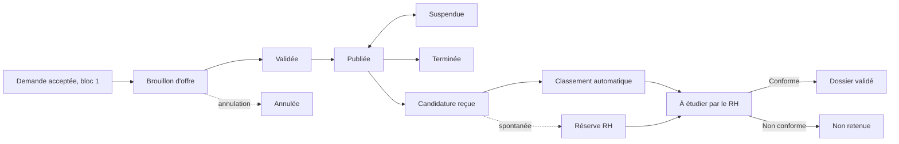

# Bloc 2A — Recrutement

## Objectif et parcours

Le bloc couvre les offres, le dépôt de candidatures et l'étude initiale des dossiers. Le candidat accède à la vitrine sans compte. Le RH crée une offre depuis une demande acceptée, complète et publie cette offre, puis examine les dossiers classés automatiquement.



## Données

Le script `migrations/b2a_recrutement.sql` définit les tables suivantes. Les références vers les autres blocs restent des identifiants simples, sans modification de leurs tables.

```mermaid
erDiagram
  OFFRE ||--o{ CRITERE_OFFRE : definit
  OFFRE o|--o{ CANDIDATURE : recoit
  CANDIDAT ||--o{ CANDIDATURE : depose
  CANDIDATURE ||--o{ CV_COMPETENCE : declare
  CANDIDATURE ||--o{ HISTORIQUE_CANDIDATURE : trace
  CANDIDATURE o|--o{ NOTIFICATION_RECRUTEMENT : concerne
  OFFRE o|--o{ NOTIFICATION_RECRUTEMENT : concerne
  OFFRE { int id_offre PK; string reference; int id_demande_besoin; string statut; date date_limite }
  CRITERE_OFFRE { int id_critere_offre PK; int id_offre FK; string type_critere; string nature; string libelle }
  CANDIDAT { int id_candidat PK; string email; string nom; string prenom }
  CANDIDATURE { int id_candidature PK; int id_candidat FK; int id_offre FK; string numero; string statut; string classement_auto }
  CV_COMPETENCE { int id_cv_competence PK; int id_candidature FK; string libelle }
  HISTORIQUE_CANDIDATURE { int id_historique PK; int id_candidature FK; string action; datetime date_action }
  NOTIFICATION_RECRUTEMENT { int id_notification PK; int id_candidat FK; int id_destinataire_employe; string canal; string statut_envoi }
```

Une candidature spontanée a `id_offre` nul jusqu'à son rattachement. Les notifications du recrutement sont distinctes des notifications du bloc 1. Les CV sont stockés hors du webroot.

## Règles principales

- Une offre est créée à partir d'une demande dont les dernières décisions obligatoires sont `VALIDEE` (hypothèse de transition, voir points ouverts). La création est idempotente. Une offre incomplète ne peut pas être validée/publiée.
- Une offre ouverte est publiée et sa date limite est absente ou non dépassée. La date dépassée est affichée comme clôture dérivée; son statut n'est pas muté automatiquement.
- Une seule candidature active par candidat et offre. Le dépôt valide PDF/DOCX, MIME, signature et limite de 5 Mio. Le nom disque est généré, le CV n'est jamais exposé par URL directe.
- Le classement obligatoire produit `CONFORME`, `NON_CONFORME` ou `A_REGARDER`; les critères souhaités sont affichés séparément. Les tolérances par défaut (1 niveau et 1 an) sont configurables.
- Le RH doit trancher les dossiers à regarder. Les décisions sont historisées et non répétables; un changement au classement automatique demande un commentaire.
- Les notifications sont conservées en base, l'envoi peut être simulé. Les événements métier et leurs effets sont déclenchés après commit.

### Classement — exemples

| Critères obligatoires | Résultat |
|---|---|
| Diplôme requis atteint, expérience suffisante, compétence et langue présentes | Conforme |
| Un niveau ou une année sous le seuil, sans critère clairement manquant | À regarder |
| Langue explicitement absente ou expérience au-delà de la tolérance | Non conforme |
| Compétences souhaitées absentes | Aucun effet sur le classement |

Les valeurs candidat et le motif par critère sont présentés au RH. Les paramètres `app.recrutement.tolerance-*` matérialisent les tolérances retenues provisoirement.

## Routes et rôles

| Route | Accès | Usage |
|---|---|---|
| `GET /offres`, `GET /offres/{id}` | Public | Vitrine paginée, recherche et détail |
| `GET/POST /candidatures/nouvelle` | Public | Formulaire de candidature ou candidature spontanée |
| `GET /recrutement/offres/**` et actions POST | RH | Gestion des offres et des critères |
| `GET /recrutement/notifications`, `POST .../{id}/lue` | RH | Notifications internes personnelles |
| `GET /rh/recrutement/reserve`, `POST .../{id}/rattacher` | RH | Réserve et rattachement |
| `GET /rh/recrutement/candidatures` | RH | Liste, filtres, tri validé et pagination |
| `GET /rh/recrutement/candidatures/{id}` | RH | Détail, critères, historique |
| `GET /rh/recrutement/candidatures/{id}/cv` | RH | Téléchargement contrôlé du CV |
| `POST /rh/recrutement/candidatures/{id}/valider` ou `/decider` | RH | Décision d'étude |

Tous les formulaires de mutation utilisent CSRF. Les pages JSP échappent les données affichées avec JSTL. Les formulaires métier utilisent des DTO.

## Services, notifications et planification

Les services sont sous `service.recrutement` : `OffreService`, `OffreDepuisDemandeService`, `CandidatureService`, `RattachementCandidatureService`, `ClassementCandidatureService`, `DecisionCandidatureService`, `SuiviCandidatureService`, `StockageCvService` et `NotificationRecrutementService`.

Les modèles de notification sont centralisés dans `ModeleNotificationRecrutement`. L'envoi désactivé journalise une simulation; les échecs sont persistés et les envois en attente sont retentés avec un maximum de cinq tentatives. Le rappel quotidien est configuré par `app.recrutement.rappel-cron`, fuseau `Indian/Antananarivo`, et regroupe les dossiers dont le délai de cinq jours ouvrables est dépassé. Le calendrier exclut week-ends et `app.recrutement.jours-feries`.

## Configuration

Voir `src/main/resources/application.properties`. Variables utiles : `APP_CV_DOSSIER_STOCKAGE`, `APP_MAIL_ACTIF`, `APP_MAIL_EXPEDITEUR`, `MAIL_HOST`, `MAIL_PORT`, `MAIL_USERNAME`, `MAIL_PASSWORD`, `APP_RECRUTEMENT_RH_EMPLOYE_IDS`, `APP_RECRUTEMENT_JOURS_FERIES`, `APP_RECRUTEMENT_TOLERANCE_EXPERIENCE`, `APP_RECRUTEMENT_TOLERANCE_NIVEAU`, `APP_RECRUTEMENT_DELAI_ETUDE_JOURS` et `APP_RECRUTEMENT_RAPPEL_CRON`. Aucun secret n'est codé dans le dépôt. Hibernate conserve `ddl-auto=none`; appliquer les migrations explicitement.

## Événements d'intégration

`DossierValideEvent` contient les identifiants de candidature, candidat et offre ainsi que le numéro de candidature. Il est publié après commit; le journal local confirme sa publication. Le bloc 2B doit écouter cet événement pour créer l'accès candidat et envoyer la convocation. Le bloc 2A ne crée aucun compte candidat.

Les autres événements couvrent réception/rattachement de candidature, candidature non retenue, création/annulation d'offre et alimentent les notifications après commit.

## Vérification et limites

Compilation et tests unitaires ciblés : `mvn -q -DskipTests compile` et `mvn -q -Dtest=ClassementCandidatureServiceTest,JoursOuvrablesServiceTest,StockageCvServiceTest test` avec Java 21. Les tests PostgreSQL, contrôleurs MockMvc et le jeu SQL doivent être exécutés sur PostgreSQL réel; H2 ne convient pas aux index partiels. Voir [`avancement.md`](avancement.md) pour l'état détaillé.

## Points ouverts

1. Statut final et événement d'acceptation du circuit du bloc 1; la déduction actuelle est provisoire.
2. Confirmation du lien de `critere_recrutement` avec une demande dans la migration bloc 1 en conflit.
3. Clôture à date limite dérivée ou statut `TERMINEE` automatique.
4. Source RH réelle et contrat avec l'authentification du bloc 1.
5. Tolérances de classement, champs définitifs du CV, événement attendu par Edinah.
6. Motif d'annulation et durée de conservation des candidatures.
7. PostgreSQL local indisponible pour validation de schéma, seed et tests d'intégration.
