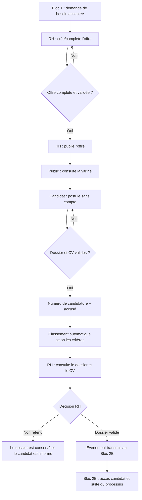

# Bloc 2A — parcours utilisateur en 2 minutes

## En une phrase

Le Bloc 2A transforme un besoin de recrutement accepté en offre, permet au public de postuler, puis donne au RH les outils pour étudier les dossiers et transmettre les candidats retenus au Bloc 2B.

## Le parcours principal

## Qui fait quoi ?

| Acteur | Action | Où commencer |
|---|---|---|
| RH | Ouvre une demande acceptée, crée l'offre, renseigne les critères, valide et publie. | Menu **Recrutement → Créer une offre depuis une demande** |
| Candidat / public | Consulte les offres et dépose son dossier; aucun compte n'est nécessaire pour postuler. | `/offres` puis **Postuler**; candidature spontanée via le lien correspondant |
| RH | Filtre les candidatures, examine les critères et le CV protégé, puis décide. | **Suivi des candidatures** |
| Bloc 2B | Reçoit le dossier validé pour les tests et les étapes suivantes. | Déclenché automatiquement à la validation RH |

## Les deux décisions à retenir

- **Offre** : elle passe de brouillon à publiée après saisie, validation et publication par le RH. Une offre suspendue peut être reprise; elle peut aussi être terminée ou annulée selon son état.
- **Candidature** : après dépôt, elle est classée automatiquement (`CONFORME`, `A_REGARDER` ou `NON_CONFORME`). Le classement aide le RH, mais la décision finale reste humaine. La validation du dossier envoie l'événement d'intégration au Bloc 2B.

## Cas rapide : candidature spontanée

Le candidat choisit **Candidature spontanée** sur la vitrine et envoie son dossier sans choisir d'offre. Le RH retrouve ce dossier dans la **réserve** et peut le rattacher à une offre ouverte. Le dossier rejoint alors le suivi normal des candidatures.

## À ne pas confondre

Le candidat peut consulter les offres et postuler publiquement sans se connecter. Le Bloc 2A ne crée pas lui-même son compte : le dossier validé est transmis au Bloc 2B, qui prend en charge l'accès candidat et les tests. L'envoi réel des courriels dépend de la configuration de messagerie; les notifications internes restent consultables dans l'application.

## Repères utiles

- Vitrine publique : `GET /offres`
- Détail public : `GET /offres/{id}`
- Formulaire de candidature : `GET /candidatures/nouvelle`
- Gestion RH des offres : `/recrutement/offres`
- Suivi RH : `/rh/recrutement/candidatures`
- Réserve spontanée RH : `/rh/recrutement/reserve`

Pour les règles métier, les données, la configuration et les limites techniques, voir [`bloc2a.md`](bloc2a.md).
