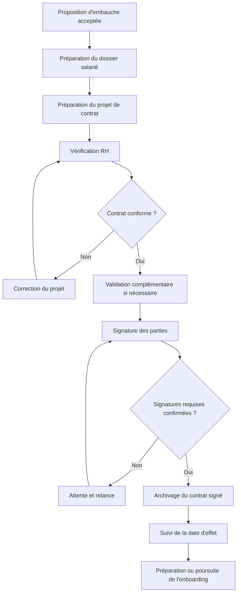
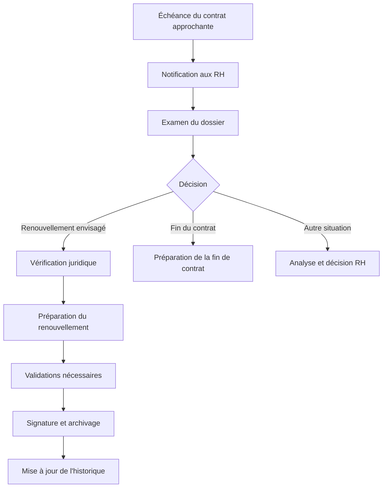
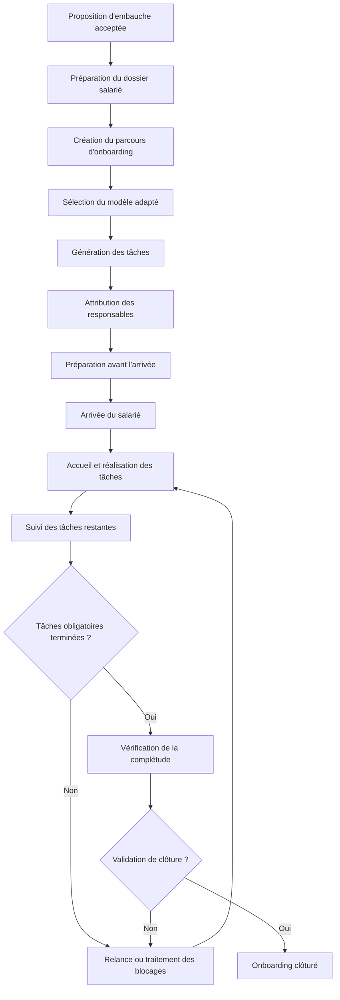
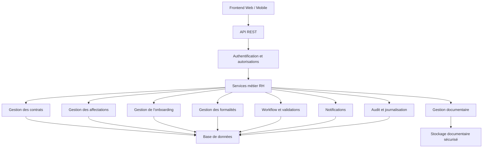
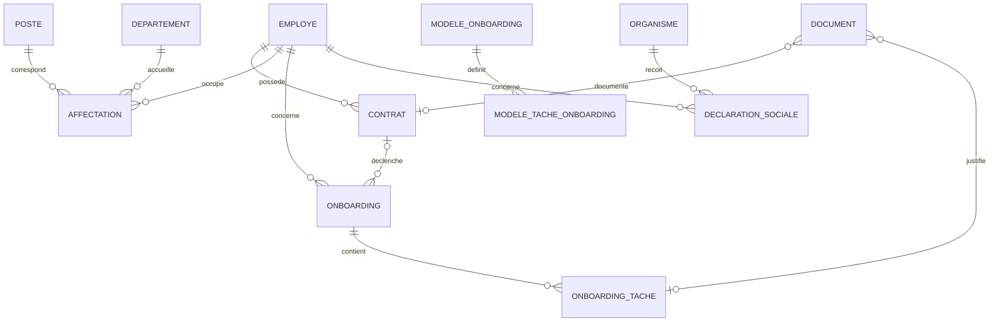

# BLOC 4 — CONTRAT ET ONBOARDING
## Analyse métier, règles de gestion et workflows d'un SIRH

## 1. Objectif du bloc

Le bloc 4 couvre la gestion du contrat de travail et l'intégration du salarié dans l'entreprise.

Il intervient après la sélection et l'embauche du candidat (bloc 3) et permet d'organiser la relation contractuelle, les formalités administratives et l'intégration opérationnelle du nouveau salarié.

L'objectif est de concevoir un module SIRH capable de :
- Gérer les contrats de travail et leur historique.
- Gérer les renouvellements et les avenants.
- Suivre les affectations des salariés.
- Organiser l'intégration avant et après l'arrivée.
- Générer et suivre des checklists d'onboarding.
- Coordonner les différents services concernés.
- Gérer les documents et les validations.
- Suivre les échéances et les formalités administratives.
- Garantir la traçabilité et la confidentialité des données.

**Principe fondamental : le logiciel ne doit pas se limiter à enregistrer des informations. Il doit piloter des processus métier, appliquer des règles de gestion et suivre les actions jusqu'à leur réalisation.**

---

# 2. Périmètre fonctionnel

Le bloc 4 comprend six domaines fonctionnels principaux.

| Domaine | Description |
|---|---|
| Gestion des contrats | Préparation, validation, signature, renouvellement, avenants et archivage. |
| Gestion des affectations | Suivi des postes, départements, responsables et périodes d'affectation. |
| Gestion de l'onboarding | Organisation de l'intégration du salarié avant et après son arrivée. |
| Gestion documentaire | Gestion des contrats, pièces administratives, justificatifs et documents internes. |
| Gestion des formalités | Suivi des démarches sociales, administratives et de santé au travail applicables. |
| Notifications et suivi | Rappels, échéances, tâches en retard, validations en attente et tableaux de bord. |

Ces domaines sont des modules fonctionnels. Ils peuvent être implémentés dans une seule application modulaire.

---

# 3. Acteurs du processus

| Acteur | Responsabilités |
|---|---|
| Responsable RH | Piloter les processus, préparer les contrats, vérifier les dossiers et suivre l'onboarding. |
| Direction | Valider les décisions relevant de son autorité. |
| Manager | Préparer l'arrivée, organiser l'accueil et accompagner le salarié. |
| Service juridique | Examiner les clauses ou situations contractuelles particulières, si nécessaire. |
| Service informatique | Préparer les comptes, les accès et les équipements informatiques. |
| Services généraux | Préparer le poste de travail, les badges et les équipements non informatiques. |
| Service paie / comptabilité | Vérifier les informations nécessaires à la rémunération et à la paie. |
| Responsable administratif | Préparer et suivre les formalités administratives et sociales. |
| Service de santé au travail | Assurer le suivi médical applicable selon les règles en vigueur. |
| Salarié | Fournir les informations requises, signer les documents et participer à son intégration. |

Dans une petite entreprise, une même personne peut exercer plusieurs de ces fonctions.

Le SIRH doit distinguer les rôles fonctionnels des personnes effectivement responsables des actions.

---

# 4. Gestion des contrats de travail

## 4.1. Principe général

Un salarié peut avoir plusieurs contrats successifs au cours de sa carrière dans l'entreprise.

Exemple :

1. Contrat à durée déterminée (CDD).
2. Renouvellement du CDD, lorsque celui-ci est juridiquement possible.
3. Passage à un contrat à durée indéterminée (CDI).
4. Avenant modifiant certaines conditions contractuelles.

Le logiciel doit conserver l'historique complet de ces événements.

**Un nouveau contrat ne doit jamais écraser les informations d'un contrat précédent.**

Il faut également distinguer :
- Le contrat en préparation.
- Le contrat validé.
- Le contrat signé.
- Le contrat entré en vigueur.
- Le contrat terminé ou ayant pris fin.

La signature, l'entrée en vigueur et la prise de poste sont des événements distincts.

## 4.2. Types de contrats à prendre en charge

### CDI — Contrat à durée indéterminée

Informations principales :
- Date de signature.
- Date d'effet.
- Date de début du travail.
- Fonction.
- Catégorie professionnelle.
- Rémunération.
- Clauses contractuelles.
- Document signé.
- Statut du contrat.

La date de fin peut être vide lorsqu'aucun terme contractuel n'est prévu.

### CDD — Contrat à durée déterminée

Informations supplémentaires :
- Date de début.
- Date de fin prévue.
- Motif du recours au CDD, si nécessaire.
- Contrat précédent, lorsqu'il existe.
- Informations relatives aux renouvellements.
- Décision concernant la suite du contrat.
- Échéances à surveiller.

### Renouvellement

Le renouvellement doit être géré comme une opération distincte et traçable.

Le système doit :
- Conserver le contrat précédent.
- Enregistrer la décision de renouvellement.
- Effectuer les validations nécessaires.
- Préparer le document approprié.
- Enregistrer les nouvelles dates et conditions.
- Conserver les signatures requises.
- Vérifier les règles juridiques applicables.

### Avenant

Un avenant peut notamment concerner :
- La rémunération.
- La fonction.
- Certaines conditions contractuelles.
- D'autres clauses nécessitant une modification formalisée.

Le système doit conserver la version initiale, l'avenant et leurs dates d'effet.

Une modification d'affectation n'implique pas automatiquement qu'un avenant est nécessaire : cela dépend de la situation et des règles applicables.

## 4.3. Données d'un contrat

Objet métier : `Contrat`

Attributs indicatifs :

- `id`
- `employe_id`
- `reference`
- `type_contrat`
- `date_signature`
- `date_debut`
- `date_fin`
- `fonction`
- `categorie_professionnelle`
- `salaire`
- `statut_workflow`
- `statut_contractuel`
- `contrat_precedent_id`
- `document_signe_id`
- `date_creation`
- `cree_par_id`

Le modèle doit être adapté aux exigences contractuelles et aux besoins de l'entreprise.

Les informations de rémunération, les documents et les signatures doivent bénéficier de contrôles d'accès appropriés.

## 4.4. Règles de gestion des contrats

| Code | Règle |
|---|---|
| RG-C01 | Chaque contrat doit être associé à un salarié identifié. |
| RG-C02 | Chaque contrat possède un identifiant unique. |
| RG-C03 | Les contrats successifs doivent être conservés sans écrasement de l'historique. |
| RG-C04 | Les dates doivent être cohérentes avec le type de contrat et les règles applicables. |
| RG-C05 | Un projet de contrat ne doit pas être considéré comme signé avant la confirmation des signatures requises. |
| RG-C06 | La date de signature doit être distinguée de la date d'effet et de la date de prise de poste. |
| RG-C07 | Le document signé doit être conservé dans une version identifiable. |
| RG-C08 | Les modifications contractuelles doivent être traçables. |
| RG-C09 | Un avenant ne doit pas effacer la version contractuelle précédente. |
| RG-C10 | Un renouvellement doit suivre un processus contrôlé. |
| RG-C11 | Les échéances contractuelles doivent pouvoir déclencher des alertes. |
| RG-C12 | La fin d'un contrat ne doit pas supprimer le dossier salarié. |
| RG-C13 | Les accès aux contrats doivent être limités aux personnes habilitées. |
| RG-C14 | Une annulation ou une correction importante doit être traçable. |
| RG-C15 | Le système ne doit pas renouveler automatiquement un contrat sans décision autorisée. |

---

# 5. Workflow de gestion d'un contrat

## 5.1. Workflow principal



Le nombre de validations dépend de la politique interne de l'entreprise.

## 5.2. États possibles du contrat

| État | Signification |
|---|---|
| BROUILLON | Contrat en préparation. |
| A_VALIDER | Contrat en attente de validation. |
| A_SIGNER | Contrat validé, en attente des signatures. |
| SIGNE | Signatures requises confirmées. |
| EN_VIGUEUR | Contrat entré en vigueur. |
| TERMINE | Contrat arrivé à son terme ou ayant pris fin. |
| ANNULE | Processus contractuel annulé selon les règles applicables. |

Il est préférable de distinguer :
- Le statut du workflow administratif.
- Le statut contractuel.
- La période de validité du contrat.

Un contrat signé peut, par exemple, ne pas être encore en vigueur si sa date d'effet est future.

## 5.3. Workflow de renouvellement



Les conditions de renouvellement, les durées et les limites applicables doivent être déterminées à partir du droit en vigueur et du type de contrat.

---

# 6. Gestion des affectations

## 6.1. Principe

L'affectation décrit la position organisationnelle du salarié pendant une période donnée.

Elle permet d'identifier :
- Le poste occupé.
- Le département.
- Le responsable hiérarchique.
- Le site de travail.
- La date de début.
- La date de fin éventuelle.
- Le motif du changement.

Une affectation est indépendante du contrat, même si certaines modifications d'affectation peuvent entraîner des conséquences contractuelles.

## 6.2. Données d'une affectation

Objet métier : `Affectation`

Attributs indicatifs :

- `id`
- `employe_id`
- `poste_id`
- `departement_id`
- `contrat_id`, si pertinent
- `responsable_id`
- `site_id`
- `date_debut`
- `date_fin`
- `motif`
- `statut`

## 6.3. Règles de gestion

| Code | Règle |
|---|---|
| RG-AF01 | Toute affectation doit être associée à un salarié existant. |
| RG-AF02 | Le poste et le département doivent être identifiés. |
| RG-AF03 | Les dates de début et de fin doivent être cohérentes. |
| RG-AF04 | Les affectations précédentes doivent être conservées. |
| RG-AF05 | Le responsable applicable pendant chaque période doit pouvoir être retrouvé. |
| RG-AF06 | Un changement d'affectation doit déclencher les actions complémentaires nécessaires. |
| RG-AF07 | Les conséquences contractuelles d'un changement doivent être examinées selon la situation. |

Un changement d'affectation peut déclencher un onboarding partiel : nouveaux accès, nouvelle formation, nouveau matériel ou nouvelles responsabilités.

---

# 7. Gestion de l'onboarding

## 7.1. Définition

L'onboarding est le processus d'intégration d'un nouveau salarié.

Il commence généralement par la préparation de son arrivée et peut continuer plusieurs semaines ou plusieurs mois après sa prise de poste.

Il vise à :
- Préparer les documents et formalités.
- Préparer le poste de travail.
- Organiser l'accueil.
- Fournir les accès et équipements.
- Présenter l'entreprise et l'équipe.
- Organiser les formations initiales.
- Accompagner le salarié dans sa prise de fonction.
- Vérifier que les tâches d'intégration sont réalisées.

## 7.2. Phases de l'onboarding

| Phase | Objectif | Exemples |
|---|---|---|
| 1. Préparation | Préparer l'arrivée | Contrat, documents, matériel, accès |
| 2. Formalités administratives | Constituer le dossier | Informations administratives, démarches sociales, paie |
| 3. Accueil | Présenter l'environnement | Équipe, entreprise, règles internes |
| 4. Mise en capacité | Permettre de travailler | Outils, accès, matériel, formations |
| 5. Suivi | Accompagner l'intégration | Points avec le manager, retours, actions complémentaires |
| 6. Clôture | Vérifier la complétude | Contrôle des tâches et validation finale |

Les délais et les tâches doivent être adaptés au poste et aux règles de l'entreprise.

## 7.3. Exemple de checklist

| Tâche | Responsable possible | Critère d'achèvement |
|---|---|---|
| Vérifier les informations administratives | RH | Informations vérifiées |
| Préparer le contrat | RH | Projet préparé |
| Enregistrer les signatures requises | RH | Signatures confirmées |
| Archiver le contrat signé | RH | Document archivé |
| Vérifier les pièces administratives | RH | Pièces contrôlées |
| Préparer les informations de paie | Service paie | Informations validées |
| Préparer les démarches sociales | Administration | Démarches préparées ou suivies |
| Organiser le suivi de santé au travail applicable | RH / Responsable habilité | Rendez-vous ou formalité suivie |
| Préparer le poste de travail | Services généraux | Poste prêt |
| Préparer les équipements | Informatique / Services généraux | Équipements disponibles |
| Créer les comptes professionnels | Informatique | Comptes créés |
| Configurer les autorisations | Informatique | Accès conformes au rôle |
| Présenter le salarié à l'équipe | Manager | Présentation réalisée |
| Présenter les règles internes | RH / Manager | Présentation confirmée |
| Organiser les formations initiales | Manager / Formateur | Formations réalisées |
| Effectuer un point d'intégration | Manager | Point réalisé |
| Recueillir les retours du salarié | RH / Manager | Retour enregistré |
| Vérifier la complétude | RH | Contrôle réalisé |

Cette checklist est un modèle adaptable. Toutes les tâches ne sont pas obligatoires pour tous les salariés.

## 7.4. Modèles d'onboarding

Le logiciel doit permettre de définir des modèles de checklist selon :
- Le poste.
- Le département.
- Le site.
- La catégorie de personnel.
- Les équipements nécessaires.
- Les exigences de sécurité.
- Les besoins de formation.

Exemple : un développeur informatique et un technicien de maintenance n'ont pas besoin de la même checklist.

Les modèles doivent être versionnés afin qu'une modification future ne change pas silencieusement les parcours déjà créés.

---

# 8. Modèle de données de l'onboarding

## 8.1. Objet Onboarding

Attributs indicatifs :

- `id`
- `employe_id`
- `contrat_id`
- `modele_onboarding_id`
- `date_debut_prevue`
- `date_debut_reelle`
- `date_fin_prevue`
- `date_cloture`
- `statut`
- `responsable_rh_id`

## 8.2. Objet OnboardingTache

Attributs indicatifs :

- `id`
- `onboarding_id`
- `modele_tache_id`
- `titre`
- `description`
- `responsable_id`
- `date_echeance`
- `statut`
- `date_debut`
- `date_realisation`
- `realise_par_id`
- `commentaire`
- `motif_blocage`
- `obligatoire`
- `bloquante`

## 8.3. Objet ModeleOnboarding

Attributs indicatifs :

- `id`
- `nom`
- `description`
- `departement_id`
- `poste_id`
- `version`
- `actif`

## 8.4. Objet ModeleTacheOnboarding

Attributs indicatifs :

- `id`
- `modele_onboarding_id`
- `titre`
- `description`
- `role_responsable`
- `delai_indicatif`
- `obligatoire`
- `ordre`
- `condition_activation`

## 8.5. Règles de gestion de l'onboarding

| Code | Règle |
|---|---|
| RG-ON01 | Un onboarding doit être associé au salarié concerné. |
| RG-ON02 | Chaque onboarding doit avoir un responsable de suivi. |
| RG-ON03 | Chaque tâche doit être rattachée à un onboarding. |
| RG-ON04 | Chaque tâche doit avoir un responsable ou une règle d'attribution. |
| RG-ON05 | Une tâche terminée doit conserver sa date de réalisation. |
| RG-ON06 | Une tâche bloquée doit pouvoir expliquer son blocage. |
| RG-ON07 | Une tâche obligatoire ne peut pas être considérée comme terminée sans satisfaire ses critères d'achèvement. |
| RG-ON08 | Les tâches générées doivent conserver la référence à la version du modèle utilisée. |
| RG-ON09 | La clôture dépend des conditions de complétude définies. |
| RG-ON10 | La réouverture d'un onboarding clôturé doit être autorisée et tracée. |
| RG-ON11 | Une tâche en retard doit être signalée. |
| RG-ON12 | Les tâches peuvent comporter des dépendances. |
| RG-ON13 | Une réaffectation doit être réservée aux utilisateurs autorisés. |
| RG-ON14 | La clôture doit enregistrer l'auteur et la date de validation. |
| RG-ON15 | Les notifications ne remplacent pas la réalisation effective des tâches. |

---

# 9. Workflow de l'onboarding

## 9.1. Workflow général



Les tâches indépendantes peuvent être réalisées en parallèle.

Le déclenchement du parcours peut commencer avant la finalisation de toutes les opérations contractuelles, à condition que les prérequis de chaque tâche soient respectés.

## 9.2. États possibles de l'onboarding

| État | Signification |
|---|---|
| A_PREPARER | Parcours identifié, préparation non commencée. |
| PREPARATION | Tâches préalables en cours. |
| PRET | Conditions prévues pour l'arrivée satisfaites ou suffisamment avancées. |
| EN_COURS | Intégration en cours. |
| BLOQUE | Une difficulté empêche la progression normale d'une partie du processus. |
| A_VERIFIER | Tâches terminées, contrôle nécessaire. |
| CLOTURE | Parcours clôturé après vérification. |
| ANNULE | Parcours annulé selon les règles applicables. |

Le statut général doit rester cohérent avec l'état des tâches.

Une tâche en retard ne rend pas nécessairement tout le parcours bloqué. Une tâche bloquante doit être distinguée d'une tâche simplement en retard.

---

# 10. Gestion des documents

## 10.1. Catégories de documents

| Catégorie | Exemples |
|---|---|
| Contrats | Projet, contrat signé, avenant |
| Documents administratifs | Pièces nécessaires au dossier salarié |
| Documents sociaux | Déclarations et justificatifs |
| Santé au travail | Justificatifs administratifs autorisés |
| Documents internes | Règlement intérieur, procédures, livret d'accueil |
| Formation | Programme, attestation de participation |
| Matériel | Bon de remise d'un équipement |

## 10.2. Objet Document

Attributs indicatifs :

- `id`
- `type_document`
- `titre`
- `emplacement_stockage`
- `date_creation`
- `date_depot`
- `depose_par_id`
- `statut_validation`
- `niveau_confidentialite`
- `version`

Le document peut être associé à un salarié, un contrat, une tâche ou une démarche administrative.

Le stockage physique peut être séparé de la base de données. Celle-ci conserve alors les métadonnées et une référence sécurisée au fichier.

## 10.3. Règles de gestion

- Distinguer un document attendu d'un document reçu.
- Distinguer un document reçu d'un document vérifié.
- Conserver une version identifiable des documents contractuels signés.
- Protéger l'accès aux documents confidentiels.
- Tracer les opérations importantes sur les documents sensibles.
- Appliquer les règles de conservation et de suppression applicables.
- Empêcher l'accès public aux pièces privées.

---

# 11. Particularités réglementaires à Madagascar

Cette section concerne l'adaptation du SIRH au contexte malgache.

Les obligations précises doivent être vérifiées dans les textes applicables avant leur automatisation.

## 11.1. Code du travail malgache

Référence principale :

Loi n° 2003-044 portant Code du travail.

Source :
https://www.assemblee-nationale.mg/wp-content/uploads/2020/11/Loi-n%C2%B0-2003-044-finale-Portant-Code-du-Travail.pdf

Points à examiner :
- Forme et contenu du contrat.
- Informations contractuelles requises.
- Signature et remise du contrat.
- Régime des CDD.
- Conditions de renouvellement.
- Modification des conditions contractuelles.
- Rupture et fin du contrat.

Conséquences pour le SIRH :
- Structurer les informations contractuelles.
- Conserver le document signé.
- Enregistrer les signatures et dates importantes.
- Suivre les échéances.
- Conserver l'historique des contrats et avenants.
- Vérifier les règles applicables avant d'autoriser une opération.

Les durées, limites de renouvellement et autres contrôles juridiques doivent être confirmés à partir des textes en vigueur.

## 11.2. CNaPS : déclarations et affiliation

La CNaPS constitue une référence pour les démarches de protection sociale concernées.

Sources :
- https://www.cnaps.mg/
- https://www.cnaps.mg/documents/telechargement

Le SIRH doit permettre de suivre :
- Les informations nécessaires à la démarche.
- La préparation de la déclaration.
- La transmission.
- Les références externes.
- Les demandes de correction.
- Les justificatifs reçus.

### Objet DeclarationSociale

Attributs indicatifs :

- `id`
- `employe_id`
- `organisme`
- `type_declaration`
- `date_preparation`
- `date_envoi`
- `reference_externe`
- `statut`
- `document_justificatif_id`
- `commentaire`

### Règles de gestion

- Une déclaration préparée ne doit pas être considérée comme transmise.
- La transmission et la confirmation doivent être distinguées.
- Les démarches en attente doivent pouvoir être suivies.
- Les justificatifs doivent être conservés selon les règles applicables.
- Les corrections doivent être traçables.

## 11.3. Santé au travail

Sources :
- OSTIE : https://ostie.mg/services
- OIT / NATLEX, décret n° 2003-1162 : https://natlex.ilo.org/dyn/natlex2/r/natlex/fe/details?p3_isn=72837

Le SIRH peut suivre les visites et formalités applicables selon le poste et les règles en vigueur.

Il doit distinguer :
- La visite à organiser.
- Le rendez-vous planifié.
- La visite réalisée.
- Le justificatif administratif reçu.
- Le suivi restant à effectuer.

Les informations médicales détaillées doivent être séparées du dossier RH général et accessibles uniquement aux personnes habilitées.

## 11.4. Protection des données personnelles

Référence :

Loi n° 2014-038 sur la protection des données à caractère personnel.

Source :
https://digital.gov.mg/2022/07/05/loi-n-2014-038-sur-la-protection-des-donnees-a-caractere-personnel/

Principes de conception :
- Collecter uniquement les données nécessaires.
- Définir les rôles et autorisations.
- Protéger les documents confidentiels.
- Limiter l'accès aux données de rémunération.
- Restreindre l'accès aux données de santé.
- Tracer les opérations sensibles.
- Définir des durées de conservation.
- Vérifier les obligations applicables au traitement des données.

La politique d'accès doit dépendre du rôle, du besoin métier et du niveau de confidentialité.

---

# 12. Notifications et gestion des échéances

## 12.1. Événements déclencheurs

| Événement | Destinataire possible |
|---|---|
| Contrat à préparer | RH |
| Contrat en attente de validation | Validateur |
| Signature manquante | Partie concernée |
| Arrivée prochaine d'un salarié | RH et manager |
| Tâche d'onboarding proche de son échéance | Responsable de la tâche |
| Tâche en retard | Responsable et RH, selon les règles |
| Déclaration en attente | Responsable administratif |
| CDD proche de son échéance | RH et responsables autorisés |
| Formation à organiser | Manager ou formateur |
| Onboarding prêt à être clôturé | RH |

## 12.2. Règles de gestion

- Une notification doit correspondre à un événement ou à une échéance identifiable.
- Le destinataire doit être déterminé selon les responsabilités.
- Le message doit préciser l'action attendue.
- Les rappels doivent éviter les répétitions inutiles.
- Une notification envoyée ne signifie pas que l'action est terminée.
- Les événements importants doivent rester consultables dans l'historique approprié.

Les délais de rappel doivent être configurables.

---

# 13. Architecture fonctionnelle et technique

## 13.1. Architecture générale



Cette architecture est indicative. Les modules peuvent partager une même application et une même base de données.

## 13.2. Technologies possibles

- Frontend Web : React, Angular ou Vue.
- API REST : Laravel, Spring Boot, Node.js ou autre framework adapté.
- Base de données : PostgreSQL ou MySQL.
- Stockage documentaire : stockage sécurisé des fichiers.
- Notifications : système de notifications internes et, si nécessaire, courriel.
- Authentification : gestion sécurisée des sessions et des permissions.
- Audit : journalisation des opérations importantes.

Le choix final doit dépendre des compétences de l'équipe, des contraintes du projet et des exigences de sécurité.

## 13.3. Exemples d'API REST

```text
POST /api/contracts
GET  /api/contracts/{id}
POST /api/contracts/{id}/submit
POST /api/contracts/{id}/approve
POST /api/contracts/{id}/record-signature

POST /api/onboardings
GET  /api/onboardings/{id}
GET  /api/onboardings/{id}/tasks

POST /api/onboarding-tasks/{id}/complete
POST /api/onboarding-tasks/{id}/block
POST /api/onboarding-tasks/{id}/reassign

GET  /api/employees/{id}/contracts
GET  /api/employees/{id}/assignments
```

Ces routes sont des exemples et non une API standardisée.

Les contrôles métier et les autorisations doivent être appliqués côté serveur.

---

# 14. Interfaces principales

## 14.1. Tableau de bord RH

Indicateurs possibles :
- Contrats en préparation.
- Contrats en attente de signature.
- Contrats proches de leur échéance.
- Salariés attendus prochainement.
- Onboardings en cours.
- Tâches en retard.
- Formalités en attente.
- Onboardings à clôturer.

## 14.2. Fiche salarié

Onglets possibles :
- Informations générales.
- Contrats.
- Affectations.
- Onboarding.
- Documents.
- Formalités.
- Historique.

Les informations confidentielles doivent être masquées ou inaccessibles aux utilisateurs non autorisés.

## 14.3. Écran de suivi de l'onboarding

Informations principales :
- Salarié.
- Poste.
- Département.
- Date d'arrivée.
- Responsable RH.
- Manager.
- État général.
- Tâches terminées.
- Tâches en retard.
- Tâches bloquées.
- Tâches restantes.

La progression en pourcentage doit être accompagnée d'indicateurs sur les tâches obligatoires et bloquantes.

Un parcours complété à 90 % peut encore être bloqué si une tâche essentielle reste inachevée.

## 14.4. Écran de gestion des contrats

Fonctionnalités :
- Préparer un contrat.
- Vérifier les données.
- Lancer les validations.
- Suivre les signatures.
- Archiver le document.
- Consulter l'historique.
- Préparer un renouvellement.
- Enregistrer un avenant.
- Consulter les échéances.

L'utilisateur doit toujours savoir si le document est un brouillon, une version validée ou un document signé.

---

# 15. Cas particuliers à gérer

| Situation | Comportement attendu |
|---|---|
| Candidat refusant la proposition | Clôturer le processus d'embauche sans créer un contrat signé. |
| Salarié absent le jour prévu | Signaler la situation et demander une décision aux RH. |
| Signature manquante | Conserver l'état d'attente et permettre les relances. |
| Document incomplet | Demander une correction et conserver l'historique utile. |
| Matériel indisponible | Signaler le blocage et notifier le responsable. |
| Responsable absent | Autoriser une réaffectation contrôlée. |
| CDD proche de l'échéance | Déclencher une alerte et attendre une décision autorisée. |
| Changement de département | Créer une nouvelle affectation et déterminer les tâches complémentaires. |
| Modification après signature | Conserver la version initiale et appliquer la procédure appropriée. |
| Tâche terminée par erreur | Permettre une correction autorisée et tracer la modification. |
| Onboarding clôturé trop tôt | Permettre une réouverture contrôlée si nécessaire. |
| Départ du salarié | Transmettre les opérations concernées au processus de sortie et conserver l'historique. |

---

# 16. MVP recommandé

Le MVP doit permettre de gérer les processus essentiels sans nécessiter immédiatement des intégrations externes complexes.

## Fonctionnalités indispensables

1. Consultation du dossier salarié.
2. Gestion des contrats successifs.
3. Suivi des dates et échéances.
4. Gestion des affectations.
5. Modèles d'onboarding.
6. Génération des tâches.
7. Attribution des responsables.
8. Suivi des statuts et des retards.
9. Gestion documentaire sécurisée.
10. Gestion des validations essentielles.
11. Contrôle d'accès par rôle.
12. Historique des opérations importantes.
13. Tableau de bord RH simple.

## Fonctionnalités pouvant être ajoutées ultérieurement

- Génération automatique des contrats.
- Signature électronique intégrée.
- Intégrations avec des organismes externes, si des interfaces adaptées sont disponibles.
- Notifications avancées.
- Tableaux de bord analytiques avancés.
- Automatisation étendue des formalités.

Dans le MVP, les déclarations peuvent être préparées et suivies manuellement. Le logiciel doit simplement distinguer ce qui a été préparé, transmis et confirmé.

---

# 17. Indicateurs de suivi

| Indicateur | Calcul indicatif |
|---|---|
| Délai de contractualisation | Date de signature − date de début du processus choisi |
| Taux de contrats signés avant l'arrivée | Contrats signés avant l'arrivée / embauches concernées |
| Taux de complétude des dossiers | Dossiers conformes / dossiers contrôlés |
| Taux de tâches réalisées à temps | Tâches terminées avant échéance / tâches terminées |
| Nombre de tâches en retard | Nombre de tâches non terminées après échéance |
| Durée moyenne d'onboarding | Durée entre le début et la clôture du parcours |
| Taux de clôture dans le délai prévu | Parcours clôturés dans le délai / parcours clôturés |
| Nombre de CDD proches de l'échéance | Contrats concernés sur la période sélectionnée |

Les définitions des indicateurs doivent être documentées pour garantir des comparaisons fiables.

---

# 18. Modèle conceptuel simplifié



Ce diagramme représente les principales relations conceptuelles. Il faudra préciser les cardinalités et les clés étrangères du schéma physique avant l'implémentation.

Les documents peuvent nécessiter des relations supplémentaires afin de permettre leur rattachement à plusieurs types d'objets métier, tout en conservant des contrôles d'accès appropriés.

---

# 19. Points de conception à retenir absolument

## Point 1 — Le contrat n'est pas un simple champ du salarié

Un salarié peut avoir plusieurs contrats successifs. Chaque contrat doit conserver ses propres dates, conditions, documents et événements.

## Point 2 — Le contrat et l'affectation sont distincts

Le contrat représente la relation contractuelle. L'affectation décrit la position du salarié dans l'organisation.

## Point 3 — Le candidat n'est pas le salarié

La création du dossier salarié intervient dans le processus d'embauche. Il faut conserver le lien avec le candidat et la candidature d'origine.

## Point 4 — L'onboarding est un workflow

Il comprend plusieurs tâches, responsables, échéances, dépendances et validations. Ce n'est pas simplement un formulaire avec quelques cases à cocher.

## Point 5 — Une tâche doit être traçable

Le système doit permettre de savoir :
- Qui est responsable.
- Ce qui doit être réalisé.
- Pour quelle échéance.
- Si la tâche est terminée.
- Qui l'a terminée.
- Quand elle a été terminée.
- Pourquoi elle est bloquée, si nécessaire.

## Point 6 — Les modèles d'onboarding doivent être réutilisables

Les tâches doivent pouvoir varier selon le poste, le département et les besoins de l'entreprise.

## Point 7 — Les notifications ne remplacent pas les actions

Une notification envoyée ne signifie pas que la tâche est terminée ni que l'obligation correspondante est satisfaite.

## Point 8 — Les documents doivent être sécurisés

Les contrats, les informations salariales et les documents sensibles ne doivent pas être accessibles à tous les utilisateurs.

## Point 9 — Les formalités malgaches doivent être intégrées au modèle

Le SIRH doit notamment permettre de suivre les démarches applicables auprès de la CNaPS et les formalités de santé au travail, selon la situation.

## Point 10 — Le droit applicable doit être vérifié

Les règles juridiques ne doivent pas être déduites uniquement des pratiques courantes. Les durées, échéances et conditions doivent être vérifiées à partir des textes en vigueur.

## Point 11 — Le système doit conserver l'historique

Les modifications contractuelles, les changements d'affectation et les opérations importantes doivent rester traçables.

## Point 12 — Le MVP doit privilégier les processus essentiels

Il vaut mieux disposer d'une gestion fiable des contrats, des affectations et des tâches d'onboarding que d'implémenter de nombreuses fonctionnalités avancées sans règles de gestion cohérentes.

---

# 20. Sources de référence

## Sources malgaches

1. **Assemblée nationale de Madagascar — Loi n° 2003-044 portant Code du travail**

   https://www.assemblee-nationale.mg/wp-content/uploads/2020/11/Loi-n%C2%B0-2003-044-finale-Portant-Code-du-Travail.pdf

2. **CNaPS — Site officiel**

   https://www.cnaps.mg/

3. **CNaPS — Formulaires et documents**

   https://www.cnaps.mg/documents/telechargement

4. **Organisation internationale du travail — NATLEX — Décret n° 2003-1162 sur la médecine d'entreprise**

   https://natlex.ilo.org/dyn/natlex2/r/natlex/fe/details?p3_isn=72837

5. **OSTIE — Services de santé au travail**

   https://ostie.mg/services

6. **Loi n° 2014-038 sur la protection des données à caractère personnel**

   https://digital.gov.mg/2022/07/05/loi-n-2014-038-sur-la-protection-des-donnees-a-caractere-personnel/

## Références professionnelles

7. **SHRM — Employee Onboarding Guide**

   https://www.shrm.org/topics-tools/topics/onboarding/process

8. **SHRM — New Employee Onboarding Guide**

   https://www.shrm.org/topics-tools/news/talent-acquisition/new-employee-onboarding-guide-talent-acquisition

---

# Conclusion

Le bloc 4 doit être conçu comme un ensemble cohérent de processus métier couvrant la gestion contractuelle, les affectations et l'intégration du salarié.

Le modèle repose principalement sur les objets suivants :

- `Employe`
- `Contrat`
- `Affectation`
- `Onboarding`
- `OnboardingTache`
- `ModeleOnboarding`
- `ModeleTacheOnboarding`
- `Document`
- `DeclarationSociale`
- `Organisme`
- `Utilisateur`
- `Validation`
- `Notification`
- `EvenementAudit`

La conception doit préserver l'historique, contrôler les transitions entre états, attribuer les responsabilités, suivre les échéances et protéger les données personnelles.

**La priorité est de traduire les processus RH en règles de gestion et en workflows cohérents avant de concevoir les tables, les API et les interfaces du logiciel.**