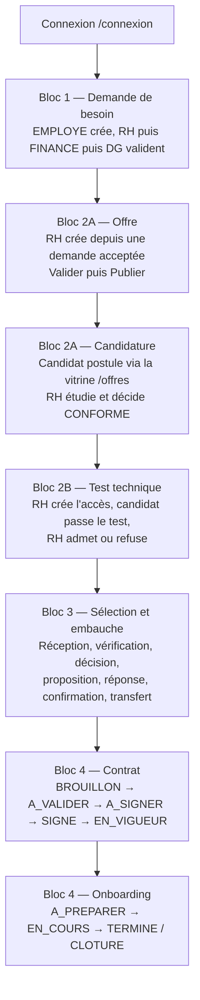
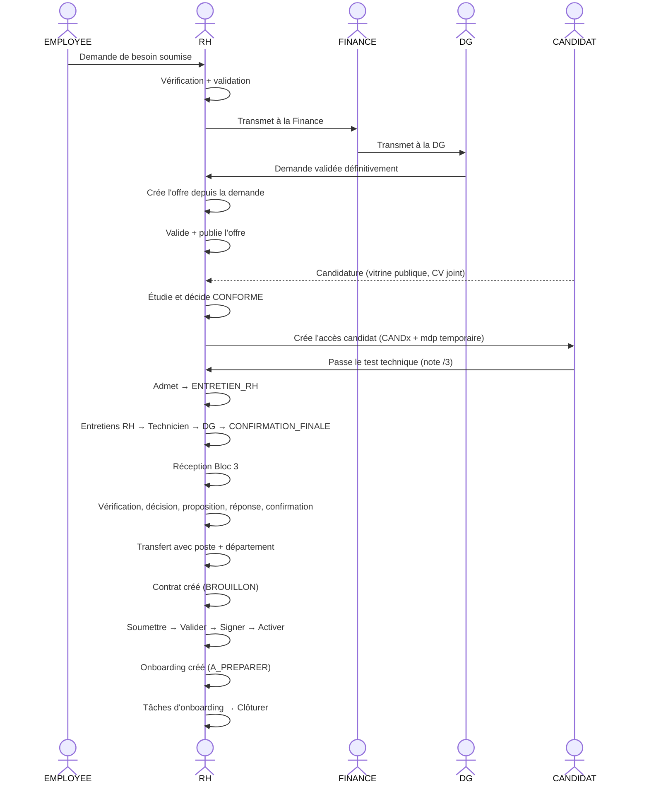

# Userflow de test — parcours complet SIRH (Bloc 1 → Bloc 7)

Ce document décrit le parcours de recette de bout en bout : **connexion → demande de besoin →
offre → candidature → test technique → sélection/embauche → contrat → onboarding**.

Il correspond à l'état de la branche `integration/bloc1-4`.

---

## 1. Prérequis

| Élément | Valeur |
|---|---|
| Java | 21 |
| Build | `./mvnw clean package -DskipTests` |
| Base | PostgreSQL `gestionrh_align` |
| Connexion | `DB_URL`, `DB_USER`, `DB_PASSWORD` en variables d'environnement |
| Port | `8080` |

### Ordre des migrations

L'ordre fait foi dans **`migrations/ordre-migrations.txt`** (source unique). Ne pas lancer les fichiers à la main :
`bloc1.sql`, `b2a_recrutement.sql`, `bloc3_faneva.sql` et `bloc4.sql` commencent par `DROP TABLE … CASCADE`
et **effacent les données** s'ils sont rejoués.

```bash
./scripts/migrations.sh status                      # où en est ma base ?
./scripts/migrations.sh apply                       # base existante : n'applique que ce qui manque
./scripts/migrations.sh apply --avec-donnees-test   # idem + jeux de démonstration
./scripts/migrations.sh reset --yes                 # repartir de zéro (efface tout)
```

Ordre de référence :

```text
migrations/bloc1.sql
migrations/bloc1_teste.sql
migrations/bloc1_employe_sortant.sql
migrations/b2a_recrutement.sql
migrations/b2a_donnees_test.sql
migrations/bloc2_test_technique.sql
migrations/bloc2_entretiens.sql
migrations/bloc3_faneva.sql
migrations/bloc3_test.sql
migrations/bloc4.sql
migrations/bloc4_referentiel.sql
migrations/bloc4_teste.sql
migrations/bloc5.sql
migrations/bloc6.sql
migrations/bloc7.sql
```

### Lancement

```bash
./mvnw spring-boot:run
```

Ou, avec le script fourni (build + WAR lancé hors des chemins avec espace + attente) :

```bash
./scripts/recette-locale.sh db-reset --yes     # base + données de test
./scripts/recette-locale.sh db-reset-empty --yes # base + comptes uniquement (pas d'offres, pas de candidats)
./scripts/recette-locale.sh start               # démarre l'application
./scripts/recette-locale.sh smoke               # contrôle HTTP des écrans principaux
./scripts/recette-locale.sh stop                # arrête l'application
```

> ⚠️ **Chemin avec espace = erreur JSP.** Le WAR exécutable (`java -jar`) ne sait pas scanner
> les jars imbriqués si le chemin du projet contient un espace (`gestion tovo`), ce qui provoque
> `TLD JSTL introuvable` et une page 500. Lancer avec `spring-boot:run`, ou copier le WAR dans un
> chemin sans espace (ex. `/tmp/opencode/run/sirh.war`).

> ⚠️ **Toujours `./mvnw clean` avant de relancer** après une modification des entités/repositories :
> sinon des classes obsolètes provoquent `BeanDefinitionOverrideException: 'candidatRepository'`.

### Deux modes de réinitialisation (`.sh`)

| Commande | Résultat après reset |
|---|---|
| `./scripts/recette-locale.sh db-reset --yes` | Schéma + **tous** les seeds (`bloc1_teste`, `b2a_donnees_test`, `bloc3_test`, `bloc4_teste`) → base avec offres (`PUBLIEE`/`BROUILLON`), candidatures, contrat `CTR-...`, onboarding `A_PREPARER` |
| `./scripts/recette-locale.sh db-reset-empty --yes` | Schéma + **uniquement** `bloc1_teste.sql` (comptes RH/DG/FINANCE/EMPLOYE + postes/départements) → pas d'offre, pas de candidat, pas de contrat, pas d'onboarding. Idéal pour un parcours manuel complet de bout en bout. |

> ⚠️ **Vitrine publique (`/offres`)** : le CSS du framework (`base.css`, `components.css`) est maintenant inclus dans `recrutement/vitrine/*.jsp`. La page publique est cohérente visuellement.

---

## 2. Comptes de test

| Rôle à choisir | Identifiant (email) | Mot de passe | Usage dans le parcours |
|---|---|---|---|
| EMPLOYEE | `henika.rasoa@entreprise.mg` | `EMPLOYEpassword123` | Créer la demande de besoin |
| RH | `marie.rabe@entreprise.mg` | `RHpassword123` | Vérifier, recruter, contrat, onboarding |
| FINANCE | `paul.andria@entreprise.mg` | `FINANCEpassword123` | Validation financière |
| DG | `jean.rakoto@entreprise.mg` | `DGpassword123` | Validation finale |
| CANDIDAT | `CAND1` (ou l'email du candidat) | *affiché à la création de l'accès* | Passer le test technique |

**Règles de connexion :**

- Le formulaire `/connexion` envoie `login = ROLE|email` pour le personnel.
- Pour le rôle **CANDIDAT**, le login est envoyé **sans préfixe** : on saisit l'identifiant
  (`CAND1`) **ou** l'email du candidat.
- Le DG peut se connecter dans n'importe quel espace ; il conserve un droit `ACCES_DG` lui
  permettant de consulter les décisions de tous les validateurs.
- Un compte candidat n'est actif qu'après la création de son accès par la RH (étape 4).

---

## 3. Vue d'ensemble



---

## 4. Étapes détaillées

### Étape 0 — Se connecter

1. Ouvrir `http://localhost:8080/connexion`.
2. Choisir le rôle, saisir l'email (ou l'identifiant candidat) et le mot de passe.
3. Cliquer **Se connecter**.

Redirections attendues :

- personnel → `/accueil`
- candidat → `/candidat`

---

### Étape 1 — Bloc 1 : créer et faire valider la demande de besoin

**Qui :** EMPLOYEE, puis RH, FINANCE, DG.

1. **EMPLOYEE** (`henika.rasoa@entreprise.mg`) → menu **Nouvelle demande** (`/demandes/nouvelle`).
2. Renseigner département, poste, motif, urgence, type de contrat, salaire, date souhaitée,
   critères de recrutement.
3. Cliquer **Soumettre la demande** (ou *Enregistrer le brouillon* pour reprendre plus tard).

Le circuit de validation est : **RH → FINANCE → DG** (`circuit_validation`).

4. **RH** → `/rh/demandes` → ouvrir la demande → **Valider et envoyer à la Finance**.
5. **FINANCE** → `/finance/demandes` → **Valider et envoyer à la DG**.
6. **DG** → `/dg/demandes` → **Valider définitivement**.

**Résultat attendu :** `demande_besoin.statut = VALIDEE`.

> En cas de correction : un validateur peut **Renvoyer pour correction** (statut `A_CORRIGER`),
> le demandeur corrige puis resoumet ; ou **Rejeter** la demande.

| Étape | Statut demande |
|---|---|
| Création | `BROUILLON` |
| Soumission | `SOUMISE` |
| Renvoi pour correction | `A_CORRIGER` |
| Validation finale DG | `VALIDEE` |
| Rejet | `REJETEE` |

---

### Étape 2 — Bloc 2A : créer l'offre

**Qui :** RH.

L'offre est **créée automatiquement** en brouillon dès la validation finale de la DG (date limite
pré-remplie à J+30, critères repris de la demande) et la RH est notifiée.

1. **RH** → menu **Recrutement → Offres d'emploi** (`/recrutement/offres`) → ouvrir l'offre en `BROUILLON`.
2. Vérifier ou compléter (titre, description, date limite, critères) via **Modifier** si besoin.
3. Cliquer **Valider et publier sur le site vitrine** : la validation RH publie l'offre (un clic).

> « Nouvelle offre » reste disponible pour une demande validée avant cette fonctionnalité.

**Résultat attendu :** `offre.statut = PUBLIEE`.

| Action | Statut offre |
|---|---|
| Création | `BROUILLON` |
| Validation | `VALIDEE` |
| Publication | `PUBLIEE` |
| Suspension / reprise | `SUSPENDUE` / `PUBLIEE` |
| Clôture | `TERMINEE` / `ANNULEE` |

> Une offre incomplète (champs manquants) affiche un avertissement et ne peut pas être validée.

---

### Étape 3 — Bloc 2A : recevoir et étudier une candidature

**Qui :** candidat (public), puis RH.

#### Dépôt de candidature

1. Se déconnecter, puis ouvrir la **vitrine publique** `http://localhost:8080/offres`
   (accessible sans authentification).
2. Ouvrir l'offre publiée → **Postuler**.
3. Remplir le formulaire public (`/candidatures/nouvelle?offreId=…`) : identité, CV numérique,
   expériences, langues, compétences, disponibilité, **CV joint en PDF ou DOCX**.
4. Valider l'envoi.

Une candidature spontanée est possible via `/candidatures/nouvelle` (sans offre).

#### Étude RH

1. **RH** → **Recrutement → Suivi des candidatures** (`/rh/recrutement/candidatures`).
2. Ouvrir le dossier → éventuellement **Valider le classement automatique**.
3. Choisir la décision finale :
   - **CONFORME** → dossier validé,
   - **NON_CONFORME** → candidature écartée.
4. **Enregistrer la décision**.

**Résultat attendu :** `candidature.statut = DOSSIER_VALIDE` (ou `NON_RETENUE`).

> Si la décision RH diffère du classement automatique, un **commentaire est obligatoire**.
> Les candidatures spontanées se rattachent à une offre via
> **Recrutement → Suivi des candidatures → Réserve** (`/rh/recrutement/reserve`).

---

### Étape 4 — Bloc 2B : test technique

**Qui :** RH puis candidat.

À la validation du dossier (étape 3), l'accès du candidat est **créé automatiquement** et l'e-mail de
convocation (identifiant + mot de passe provisoire) est préparé. Le chronomètre du test (30 min, séance
unique) ne démarre qu'à l'ouverture du test par le candidat.

1. **RH** → **Recrutement → Tests techniques** (`/rh/tests`).
2. Sans serveur de mail en recette : dans **Dossiers validés — accès au test**, cliquer
   **Renvoyer un nouvel accès** ; le message flash affiche `Compte candidat créé : CANDx / mot de passe
   temporaire xxxxxxxx`. **Noter ces deux valeurs.**
4. Se déconnecter.
5. **Candidat** → `/connexion` → rôle **CANDIDAT** → identifiant `CANDx` (ou email) + mot de passe
   temporaire → **Se connecter**.
6. L'espace `/candidat` liste **Mes candidatures** → **Passer le test**.
7. Répondre aux 3 questions puis enregistrer. La note est calculée sur **/3** avec un seuil
   (2 par défaut).
8. **RH** → `/rh/tests` :
   - **Admettre** → `candidature.statut = ENTRETIEN_RH` (convocation à l'entretien 1),
   - **Refuser** → `NON_RETENUE` (message de réponse au candidat).

**Résultat attendu :** candidature en `ENTRETIEN_RH`.

---

### Étape 4 bis — Bloc 2 : entretiens RH → Technicien → DG

**Qui :** RH. Trois niveaux dans l'ordre, sans sauter de niveau.

1. **RH** → **Recrutement → Entretiens** (`/rh/entretiens`) → **Ouvrir** la candidature.
2. **Planifier** : date et heure, lieu, jury, note générale minimale (sur 5) et grille d'évaluation
   (questions pré-remplies, importance 1 à 3, questions éliminatoires avec note minimale).
   Le candidat est convoqué ; le rendez-vous apparaît dans son espace.
3. Possible : **Reporter** (le rendez-vous d'origine est conservé) ou **Candidat absent**.
4. Le jour de l'entretien : saisir les notes du jury (1 à 5) → **Enregistrer les notes et calculer**.
   Note générale = moyenne pondérée ; résultat proposé « admis » si seuil atteint et questions
   éliminatoires respectées.
5. **Confirmer : admis** (ou non admis). Motif obligatoire si la décision diffère de la proposition.
6. Recommencer pour l'entretien 2 (Technicien) puis 3 (DG).

| Décision | Statut candidature |
|---|---|
| Entretien 1 admis | `ENTRETIEN_TECHNICIEN` |
| Entretien 2 admis | `ENTRETIEN_DG` |
| Entretien 3 admis | `CONFIRMATION_FINALE` (visible au Bloc 3) |
| Non admis (tout niveau) | `NON_RETENUE` |

**Résultat attendu :** candidature en `CONFIRMATION_FINALE` ; au Bloc 3, les notes (test /20, entretiens
/5), la note finale et le rang sont pré-remplis à la réception.

---

### Étape 5 — Bloc 3 : sélection et embauche

**Qui :** RH.

1. **RH** → **Recrutement → Sélection et embauche** (`/bloc3/selections`).
2. Section **« Dossiers prêts à recevoir »** : cliquer **Recevoir** sur la ligne du candidat.
   - le score du test est converti **/3 → /20**,
   - saisir la **note finale /5** et le **rang**.
   - La réception peut aussi se faire manuellement (formulaire « raccordement manuel »).
3. Ouvrir le dossier de sélection (`/bloc3/selections/{id}`) et dérouler le workflow :

| Ordre | Action | Bouton | Résultat |
|---|---|---|---|
| 1 | Vérification du dossier | **Enregistrer la vérification** (`COMPLET`) | dossier complet |
| 2 | Décision finale | **Enregistrer la décision** (`RETENU`) | candidat retenu |
| 3 | Proposition | **Enregistrer le brouillon** puis **Marquer comme envoyée** | proposition envoyée |
| 4 | Réponse du candidat | **Enregistrer la réponse** (`ACCEPTEE`) | proposition acceptée |
| 5 | Confirmation | **Confirmer le recrutement** (nombre de postes) | recrutement confirmé |
| 6 | Transfert Bloc 4 | choisir **poste** + **département** puis **Transférer et créer le contrat** | contrat créé |

**Résultat attendu :**

- `b3_recrutement.id_etat_recrutement = 4` (`TRANSMIS_BLOC4`),
- `b3_recrutement.id_etat_transfert = 2` (`TRANSMIS`),
- `b3_recrutement.reference_bloc4` renseignée (ex. `CTR-2026-9002`).

> Une validation supplémentaire (DG) peut être exigée selon le dossier (`validationObligatoire`).
> Dans ce cas, l'étape **Valider la décision** doit précéder la proposition.

---

### Étape 6 — Bloc 4 : contrat

**Qui :** RH.

1. **RH** → **Pilotage RH → Contrats** (`/rh/contrats`).
2. Le contrat créé par le transfert apparaît en **BROUILLON** avec la référence `CTR-AAAA-xxxx`
   (ex. `CTR-2026-9002`).
3. Ouvrir le contrat puis dérouler le workflow :

| Ordre | Action | Bouton | Statut |
|---|---|---|---|
| 1 | Rédaction / compléments | — | `BROUILLON` |
| 2 | Soumission | **Soumettre à validation** | `A_VALIDER` |
| 3 | Validation | **Valider** | `A_SIGNER` |
| 4 | Signature | **Enregistrer la signature** | `SIGNE` |
| 5 | Activation | **Activer le contrat** | `EN_VIGUEUR` |

Autres actions disponibles : **Renvoyer au rédacteur**, **Terminer le contrat**, **Annuler le
contrat**, **Avenant**, **Renouvellement** ; les échéances sont suivies sur
`/rh/contrats/echeances`.

**Résultat attendu :**

- `contrat.statut_workflow = EN_VIGUEUR`,
- un `employe` a été créé automatiquement (matricule `EMP00x`, poste et département choisis au
  transfert),
- un `onboarding` a été créé en `A_PREPARER`.

---

### Étape 7 — Bloc 4 : onboarding

**Qui :** RH.

1. **RH** → **Pilotage RH → Onboardings** (`/rh/onboardings`).
2. Ouvrir l'onboarding du nouvel employé (statut **A_PREPARER**).
3. Sur chaque tâche : **Démarrer**, **Terminer**, **Bloquer** / **Débloquer**, **Réassigner**.
4. Quand tout est terminé : **Clôturer l'onboarding**.

| État | Signification |
|---|---|
| `A_PREPARER` | créé automatiquement au transfert |
| `EN_COURS` | au moins une tâche démarrée |
| `TERMINE` | tâches terminées |
| `CLOTURE` | onboarding clôturé |

Des modèles de tâches sont disponibles sur `/rh/onboardings/modeles`
(création, duplication, activation).

---

### Étape 7 bis — Bloc 5 : dossier administratif du salarié

**Qui :** RH, puis le salarié. Référence métier : `readme/Bloc5.md`.

1. **RH** → **Salariés** → ouvrir le salarié (`/rh/salaries/{id}`).
   - En tête : ancienneté, contrat en vigueur, salaire de base et pièces obligatoires,
     **calculés** à partir des périodes en vigueur (jamais saisis).
   - Les alertes signalent un dossier incomplet, un CDD proche de son échéance, l'absence de contrat ou d'affectation.
2. **Réviser le salaire** (carte de droite) : nouveau salaire, date d'effet, motif.
   - Une baisse est refusée (RG-SA04) sauf **Correction** justifiée ; l'ancienne ligne est clôturée la veille, pas écrasée.
   - Une révision à date future apparaît dans l'historique mais le salaire affiché reste celui du jour.
3. **Pièces obligatoires** : **Déposer** ouvre le formulaire pré-rempli (`/rh/documents/nouveau?idTypeAdministratif=…`).
   - Une pièce à durée de validité exige une date d'émission ou d'expiration ; une pièce déjà expirée est refusée.
   - À la **vérification**, la nouvelle version remplace l'ancienne (`REMPLACE`, toujours consultable).
   - Traitement quotidien (et au démarrage) : `VERIFIE` → `A_RENOUVELER` → `EXPIRE`, avec notification salarié + RH.
4. **Statut administratif** : **Suspendre** / **Reprise**, puis **Enregistrer une sortie**
   (motif, date de notification, date de sortie).
   - Date future → `EN_PREAVIS` (annulable) ; appliquée automatiquement à la date.
   - Date atteinte → contrat terminé, affectation clôturée, contrats non signés annulés, compte désactivé, dossier en lecture seule.
5. **Changer d'affectation** : la précédente est clôturée la veille ; l'historique de carrière qualifie le mouvement
   (mutation, changement de poste, de responsable).
6. **Salarié** (ex. EMPLOYE `henika.rasoa@entreprise.mg`) → **Mon dossier** (`/mon-dossier`) :
   ses informations, contrats, affectations, salaire, parcours, et le dépôt des pièces demandées (statut `RECU`, à vérifier par le RH).

| Statut administratif | Signification |
|---|---|
| `EN_INTEGRATION` | salarié créé par l'embauche, contrat pas encore en vigueur |
| `ACTIF` | contrat en vigueur |
| `SUSPENDU` | contrat suspendu (maladie longue, congé maternité…) |
| `EN_PREAVIS` | sortie enregistrée à une date future |
| `SORTI` | sortie appliquée ; dossier archivé en lecture seule |

---

### Étape 7 ter — Bloc 6 : temps de travail et pointage

**Qui :** salarié, manager, RH, Finance, DG. Référence métier : `readme/Bloc6.md`.

> **Manager** d'un salarié = responsable de son affectation active (Bloc 5), à défaut un compte RESPONSABLE
> de son département, à défaut la **DG**. Avec les comptes de test, le manager de Henika Rasoa est donc la DG.
> **Mise en service** : aucun calcul ni anomalie avant la date d'application de `bloc6.sql`
> (table `parametre_temps`, clé `DATE_MISE_EN_SERVICE`).

1. **Salarié** → **Pointage** (`/pointage`) : bouton *Pointer mon entrée / ma sortie* (sens déduit, doublon < 1 min ignoré).
   La page montre le planning des 14 jours (planning publié, sinon régime ; congés affichés), le relevé du mois et les anomalies.
2. **Calcul de nuit** (et au démarrage) pour les 7 derniers jours : prévu (planning ou régime) rapproché des pointages
   et des congés/absences validés → retard, départ anticipé, heures sup. autorisées, absence non justifiée.
3. **Salarié** → *Justifier* une anomalie (heure réelle + sens si oubli). **Manager** → **Mon équipe** (`/equipe`) :
   *Accepter* (pointage correctif créé, journée recalculée, pénalité levée) ou *Confirmer* (une absence confirmée devient
   une absence injustifiée du Bloc 7). Sans réponse sous 3 jours → escaladée au RH.
4. **RH** → **Temps de travail** (`/rh/temps`) : anomalies (accepter / confirmer / classer avec motif), relevés,
   pointage manuel motivé (jamais pour soi-même), annulation d'un pointage (jamais supprimé), changement de régime daté.
5. **Planning** (`/planning`) : le manager (ou le RH) crée le planning d'un département sur ≤ 31 jours — pré-rempli
   (régime, fériés, congés validés verrouillés). Un modèle plus long que la durée journalière du régime = heures sup.
   planifiées ; nuit, dimanche, férié = heures majorées. *Enregistrer et soumettre* contrôle repos hebdomadaire,
   10 h/jour, 48 h/semaine, délai de prévenance.
   - **RH** valide → sans heures majorées : **publié** ; avec : **Finance** valide → dans le budget annuel du
     département : **publié**, sinon **arbitrage DG**. Tout rejet est motivé.
   - Un planning publié se modifie par *nouvelle version* (l'ancienne passe « Remplacé » à la publication).
6. **RH** → *Clôture et paie* (`/rh/temps/periodes`) : un mois terminé, sans anomalie ni absence en attente,
   se clôture → variables de paie (heures normales, sup., nuit, dimanche, férié, retards, absences ; congés et absences
   du Bloc 7 découpés par mois), acquisition des congés du mois, verrouillage. Export CSV.

### Étape 7 quater — Bloc 7 : congés et absences

Référence métier : `readme/Bloc7.md`. Reprise : 2,5 j de congés payés par mois complet de l'année en cours,
10 j de permissions ; un écart avec l'ancien système se corrige par **ajustement** RH.

1. **Salarié** → **Mes congés** (`/conges`) : soldes (disponible = acquis − pris − réservé), *Nouvelle demande*
   (demi-journées possibles, nombre de jours calculé). Refus immédiats : solde insuffisant, chevauchement (contrôlé aussi
   par la base), délai de prévenance (7 j pour un congé payé), durée maximale, date de fin de contrat.
2. **Manager** → **Mon équipe** : valider / refuser (motif), avec l'avertissement des collègues absents sur la période.
3. **RH** → **Congés et absences** (`/rh/conges`) : validation finale (justificatif obligatoire vérifié pour
   permission, maternité, paternité) → planning mis à jour, journées recalculées. Une demande sans réponse du manager
   depuis 3 jours est escaladée : le RH peut alors valider l'étape manager.
4. Chaque nuit : `VALIDEE` → `EN_COURS` → `PRISE` (débit définitif du solde). Le salarié annule avant le début ;
   le RH **interrompt** un congé en cours (jours non pris recrédités).
5. **Absences** : déclarées par le salarié (maladie : certificat sous 2 jours), saisies par le RH, ou constatées au
   pointage. Décision RH : justifiée (justificatif exigé), injustifiée, conversion en congé payé (accord du salarié),
   annulation. Le manager ne voit jamais le motif médical.

| Statut de demande | Signification |
|---|---|
| `SOUMISE` | en attente du manager, jours réservés |
| `VALIDEE_MANAGER` | en attente du RH |
| `VALIDEE` → `EN_COURS` → `PRISE` | validée, en cours, prise (solde débité) |
| `REFUSEE` / `ANNULEE` | jours libérés |
| `INTERROMPUE` | écourtée, seuls les jours pris sont débités |

---

### Étape 8 — Contrôles transverses

| Écran | URL | Ce qu'on vérifie |
|---|---|---|
| Tableau de bord RH | `/rh/tableau-de-bord` | indicateurs contrats/onboarding |
| Salariés | `/rh/salaries` | le nouvel employé est présent |
| Documents | `/rh/documents` | dépôt / vérification / rejet |
| Formalités | `/rh/formalites` | préparation et transmission |
| Affectations | `/rh/affectations` | rattachement poste/département |
| Mes tâches | `/mes-taches` | tâches assignées |
| Mon dossier | `/mon-dossier` | dossier du salarié connecté (Bloc 5) |
| Pointage | `/pointage` | pointer, planning, relevé, anomalies (Bloc 6) |
| Mes congés | `/conges` | soldes, demandes, absences (Bloc 7) |
| Mon équipe | `/equipe` | anomalies et congés à valider (manager) |
| Plannings | `/planning` | préparation et circuit RH → Finance → DG |
| Notifications | cloche de la barre du haut | messages et liens |
| Notifications recrutement | `/recrutement/notifications` | notifications 2A |

---

## 5. Diagramme de séquence



---

## 6. Checklist de recette

- [ ] Connexion des 4 comptes internes + du candidat
- [ ] Demande créée et validée RH → FINANCE → DG
- [ ] Offre créée, validée et publiée
- [ ] Candidature publique déposée avec CV
- [ ] Candidature classée **CONFORME** par la RH
- [ ] Accès candidat créé, test passé et noté
- [ ] Candidature admise au test → `ENTRETIEN_RH`
- [ ] Entretiens 1, 2, 3 planifiés, notés et confirmés → `CONFIRMATION_FINALE`
- [ ] Dossier reçu au Bloc 3 (« Dossiers prêts à recevoir »)
- [ ] Vérification, décision, proposition, réponse, confirmation
- [ ] Transfert Bloc 4 → contrat + employé + onboarding créés
- [ ] Contrat activé (`EN_VIGUEUR`)
- [ ] Onboarding mené jusqu'à `TERMINE` puis `CLOTURE`
- [ ] Bloc 5 : révision de salaire (hausse acceptée, baisse refusée), historique conservé
- [ ] Bloc 5 : pièce obligatoire déposée, vérifiée, puis remplacée par une nouvelle version
- [ ] Bloc 5 : sortie future (`EN_PREAVIS`) annulée ; sortie immédiate → `SORTI`, compte désactivé
- [ ] Bloc 5 : « Mon dossier » accessible au salarié, `/rh/salaries` refusé (403)
- [ ] Bloc 6 : pointage web, doublon ignoré ; pointage manuel RH motivé, refusé pour soi-même
- [ ] Bloc 6 : retard justifié puis accepté par le manager → pénalité levée ; absence confirmée → absence injustifiée
- [ ] Bloc 6 : planning avec heures majorées → RH → Finance → publié ; nouvelle version
- [ ] Bloc 6 : clôture d'un mois terminé, variables de paie, export CSV ; pointage refusé dans la période close
- [ ] Bloc 7 : demande refusée (solde, chevauchement, prévenance) ; demande valide → manager → RH → planning mis à jour
- [ ] Bloc 7 : maladie déclarée → l'anomalie d'absence disparaît ; justification exigée avant décision RH
- [ ] Bloc 7 : interruption d'un congé en cours, seuls les jours pris débités ; ajustement de solde motivé
- [ ] Aucune page en erreur 500 ; aucun message JSP/TLD dans les logs

---

## 7. Dépannage

| Symptôme | Cause probable | Solution |
|---|---|---|
| Page 500 « TLD JSTL introuvable » | lancement depuis un chemin contenant un espace | `mvn spring-boot:run` ou WAR copié dans `/tmp/...` |
| `BeanDefinitionOverrideException: 'candidatRepository'` | classes obsolètes | `./mvnw clean` puis relancer |
| « Le rôle choisi ne correspond pas à ce compte » | mauvais rôle sélectionné | choisir le rôle du compte |
| Candidat impossible à connecter | accès non créé ou compte inactif | RH → `/rh/tests` → **Renvoyer un nouvel accès** |
| `/offres/{id}` renvoie 400 | offre non ouverte (brouillon, suspendue, terminée) | publier l'offre d'abord |
| Pas de bouton « Recevoir » au Bloc 3 | candidature pas en `CONFIRMATION_FINALE` ou déjà reçue | vérifier les 3 entretiens (`/rh/entretiens`) |
| Transfert impossible | décision/proposition/réponse/confirmation incomplètes | dérouler les étapes du tableau §5 |

---

## 8. Écarts connus (documentés)

- Les vues historiques du Bloc 2A (`/WEB-INF/views/recrutement/*`) sont désormais rendues dans le
  gabarit commun (barre latérale + barre du haut). Un bloc de styles de transition subsiste dans
  `fragments/entete.jsp` tant que leur balisage n'est pas migré vers les classes communes.
- Entretiens en version simplifiée : la RH planifie et saisit les notes du jury ; pas de réservation
  de créneau par le candidat ni de saisie individuelle par chaque juré (écarts assumés au Bloc 2).
- Réponses libres du test corrigées par la RH (et non par la direction responsable).
- Les notifications de recrutement 2A restent sur un écran dédié
  (`/recrutement/notifications`) en plus de la cloche commune.
