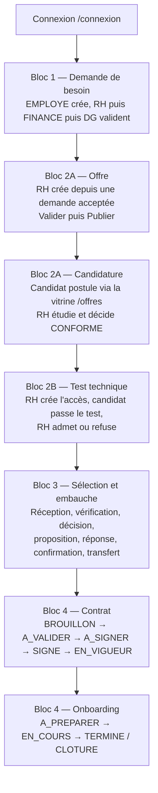
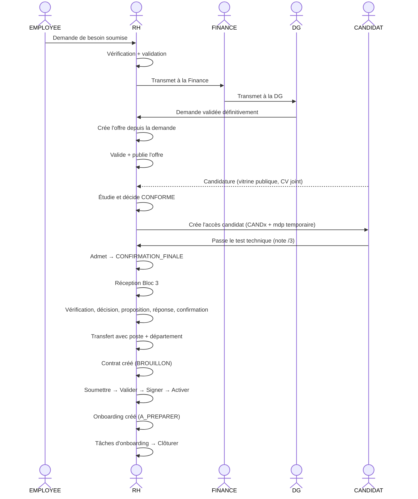

# Userflow de test — parcours complet SIRH (Bloc 1 → Bloc 4)

Ce document décrit le parcours de recette de bout en bout : **connexion → demande de besoin →
offre → candidature → test technique → sélection/embauche → contrat → onboarding**.

Il correspond à l'état de la branche `integration/bloc1-4`.

---

## 1. Prérequis

| Élément | Valeur |
|---|---|
| Java | 21 |
| Build | `./mvnw clean package -DskipTests` |
| Base | PostgreSQL `gestionrh_align` |
| Connexion | `DB_URL`, `DB_USER`, `DB_PASSWORD` en variables d'environnement |
| Port | `8080` |

### Ordre des migrations (base neuve)

À exécuter **dans cet ordre** :

```text
migrations/bloc1.sql
migrations/bloc1_teste.sql
migrations/b2a_recrutement.sql
migrations/b2a_donnees_test.sql
migrations/bloc2_test_technique.sql
migrations/bloc3_faneva.sql
migrations/bloc3_test.sql
migrations/bloc4.sql
migrations/bloc4_teste.sql
```

### Lancement

```bash
./mvnw spring-boot:run
```

> ⚠️ **Chemin avec espace = erreur JSP.** Le WAR exécutable (`java -jar`) ne sait pas scanner
> les jars imbriqués si le chemin du projet contient un espace (`gestion tovo`), ce qui provoque
> `TLD JSTL introuvable` et une page 500. Lancer avec `spring-boot:run`, ou copier le WAR dans un
> chemin sans espace (ex. `/tmp/opencode/run/sirh.war`).

> ⚠️ **Toujours `./mvnw clean` avant de relancer** après une modification des entités/repositories :
> sinon des classes obsolètes provoquent `BeanDefinitionOverrideException: 'candidatRepository'`.

---

## 2. Comptes de test

| Rôle à choisir | Identifiant (email) | Mot de passe | Usage dans le parcours |
|---|---|---|---|
| EMPLOYEE | `henika.rasoa@entreprise.mg` | `EMPLOYEpassword123` | Créer la demande de besoin |
| RH | `marie.rabe@entreprise.mg` | `RHpassword123` | Vérifier, recruter, contrat, onboarding |
| FINANCE | `paul.andria@entreprise.mg` | `FINANCEpassword123` | Validation financière |
| DG | `jean.rakoto@entreprise.mg` | `DGpassword123` | Validation finale |
| CANDIDAT | `CAND1` (ou l'email du candidat) | *affiché à la création de l'accès* | Passer le test technique |

**Règles de connexion :**

- Le formulaire `/connexion` envoie `login = ROLE|email` pour le personnel.
- Pour le rôle **CANDIDAT**, le login est envoyé **sans préfixe** : on saisit l'identifiant
  (`CAND1`) **ou** l'email du candidat.
- Le DG peut se connecter dans n'importe quel espace ; il conserve un droit `ACCES_DG` lui
  permettant de consulter les décisions de tous les validateurs.
- Un compte candidat n'est actif qu'après la création de son accès par la RH (étape 4).

---

## 3. Vue d'ensemble



---

## 4. Étapes détaillées

### Étape 0 — Se connecter

1. Ouvrir `http://localhost:8080/connexion`.
2. Choisir le rôle, saisir l'email (ou l'identifiant candidat) et le mot de passe.
3. Cliquer **Se connecter**.

Redirections attendues :

- personnel → `/accueil`
- candidat → `/candidat`

---

### Étape 1 — Bloc 1 : créer et faire valider la demande de besoin

**Qui :** EMPLOYEE, puis RH, FINANCE, DG.

1. **EMPLOYEE** (`henika.rasoa@entreprise.mg`) → menu **Nouvelle demande** (`/demandes/nouvelle`).
2. Renseigner département, poste, motif, urgence, type de contrat, salaire, date souhaitée,
   critères de recrutement.
3. Cliquer **Soumettre la demande** (ou *Enregistrer le brouillon* pour reprendre plus tard).

Le circuit de validation est : **RH → FINANCE → DG** (`circuit_validation`).

4. **RH** → `/rh/demandes` → ouvrir la demande → **Valider et envoyer à la Finance**.
5. **FINANCE** → `/finance/demandes` → **Valider et envoyer à la DG**.
6. **DG** → `/dg/demandes` → **Valider définitivement**.

**Résultat attendu :** `demande_besoin.statut = VALIDEE`.

> En cas de correction : un validateur peut **Renvoyer pour correction** (statut `A_CORRIGER`),
> le demandeur corrige puis resoumet ; ou **Rejeter** la demande.

| Étape | Statut demande |
|---|---|
| Création | `BROUILLON` |
| Soumission | `SOUMISE` |
| Renvoi pour correction | `A_CORRIGER` |
| Validation finale DG | `VALIDEE` |
| Rejet | `REJETEE` |

---

### Étape 2 — Bloc 2A : créer l'offre

**Qui :** RH.

1. **RH** → menu **Recrutement → Offres d'emploi** (`/recrutement/offres`).
2. Cliquer **Nouvelle offre**.
3. Choisir une **demande acceptée** dans la liste (les demandes `VALIDEE` sans offre active).
   L'offre hérite du poste, du département et du type de contrat de la demande.
4. Compléter la référence, le titre, la description, la date limite, les critères.
5. Ouvrir l'offre → **Valider**, puis **Publier sur le site vitrine**.

**Résultat attendu :** `offre.statut = PUBLIEE`.

| Action | Statut offre |
|---|---|
| Création | `BROUILLON` |
| Validation | `VALIDEE` |
| Publication | `PUBLIEE` |
| Suspension / reprise | `SUSPENDUE` / `PUBLIEE` |
| Clôture | `TERMINEE` / `ANNULEE` |

> Une offre incomplète (champs manquants) affiche un avertissement et ne peut pas être validée.

---

### Étape 3 — Bloc 2A : recevoir et étudier une candidature

**Qui :** candidat (public), puis RH.

#### Dépôt de candidature

1. Se déconnecter, puis ouvrir la **vitrine publique** `http://localhost:8080/offres`
   (accessible sans authentification).
2. Ouvrir l'offre publiée → **Postuler**.
3. Remplir le formulaire public (`/candidatures/nouvelle?offreId=…`) : identité, CV numérique,
   expériences, langues, compétences, disponibilité, **CV joint en PDF ou DOCX**.
4. Valider l'envoi.

Une candidature spontanée est possible via `/candidatures/nouvelle` (sans offre).

#### Étude RH

1. **RH** → **Recrutement → Suivi des candidatures** (`/rh/recrutement/candidatures`).
2. Ouvrir le dossier → éventuellement **Valider le classement automatique**.
3. Choisir la décision finale :
   - **CONFORME** → dossier validé,
   - **NON_CONFORME** → candidature écartée.
4. **Enregistrer la décision**.

**Résultat attendu :** `candidature.statut = DOSSIER_VALIDE` (ou `NON_RETENUE`).

> Si la décision RH diffère du classement automatique, un **commentaire est obligatoire**.
> Les candidatures spontanées se rattachent à une offre via
> **Recrutement → Suivi des candidatures → Réserve** (`/rh/recrutement/reserve`).

---

### Étape 4 — Bloc 2B : test technique

**Qui :** RH puis candidat.

1. **RH** → **Recrutement → Tests techniques** (`/rh/tests`).
2. Dans **Dossiers validés**, cliquer **Créer l'accès** pour la candidature concernée.
3. Un message flash affiche : `Compte candidat créé : CANDx / mot de passe temporaire xxxxxxxx`.
   **Noter ces deux valeurs.**
4. Se déconnecter.
5. **Candidat** → `/connexion` → rôle **CANDIDAT** → identifiant `CANDx` (ou email) + mot de passe
   temporaire → **Se connecter**.
6. L'espace `/candidat` liste **Mes candidatures** → **Passer le test**.
7. Répondre aux 3 questions puis enregistrer. La note est calculée sur **/3** avec un seuil
   (2 par défaut).
8. **RH** → `/rh/tests` :
   - **Admettre** → `candidature.statut = CONFIRMATION_FINALE` (le dossier part au Bloc 3),
   - **Refuser** → `NON_RETENUE`.

**Résultat attendu :** candidature en `CONFIRMATION_FINALE`, visible dans le Bloc 3.

---

### Étape 5 — Bloc 3 : sélection et embauche

**Qui :** RH.

1. **RH** → **Recrutement → Sélection et embauche** (`/bloc3/selections`).
2. Section **« Dossiers prêts à recevoir »** : cliquer **Recevoir** sur la ligne du candidat.
   - le score du test est converti **/3 → /20**,
   - saisir la **note finale /5** et le **rang**.
   - La réception peut aussi se faire manuellement (formulaire « raccordement manuel »).
3. Ouvrir le dossier de sélection (`/bloc3/selections/{id}`) et dérouler le workflow :

| Ordre | Action | Bouton | Résultat |
|---|---|---|---|
| 1 | Vérification du dossier | **Enregistrer la vérification** (`COMPLET`) | dossier complet |
| 2 | Décision finale | **Enregistrer la décision** (`RETENU`) | candidat retenu |
| 3 | Proposition | **Enregistrer le brouillon** puis **Marquer comme envoyée** | proposition envoyée |
| 4 | Réponse du candidat | **Enregistrer la réponse** (`ACCEPTEE`) | proposition acceptée |
| 5 | Confirmation | **Confirmer le recrutement** (nombre de postes) | recrutement confirmé |
| 6 | Transfert Bloc 4 | choisir **poste** + **département** puis **Transférer et créer le contrat** | contrat créé |

**Résultat attendu :**

- `b3_recrutement.id_etat_recrutement = 4` (`TRANSMIS_BLOC4`),
- `b3_recrutement.id_etat_transfert = 2` (`TRANSMIS`),
- `b3_recrutement.reference_bloc4` renseignée (ex. `CTR-2026-9002`).

> Une validation supplémentaire (DG) peut être exigée selon le dossier (`validationObligatoire`).
> Dans ce cas, l'étape **Valider la décision** doit précéder la proposition.

---

### Étape 6 — Bloc 4 : contrat

**Qui :** RH.

1. **RH** → **Pilotage RH → Contrats** (`/rh/contrats`).
2. Le contrat créé par le transfert apparaît en **BROUILLON** avec la référence `CTR-AAAA-xxxx`
   (ex. `CTR-2026-9002`).
3. Ouvrir le contrat puis dérouler le workflow :

| Ordre | Action | Bouton | Statut |
|---|---|---|---|
| 1 | Rédaction / compléments | — | `BROUILLON` |
| 2 | Soumission | **Soumettre à validation** | `A_VALIDER` |
| 3 | Validation | **Valider** | `A_SIGNER` |
| 4 | Signature | **Enregistrer la signature** | `SIGNE` |
| 5 | Activation | **Activer le contrat** | `EN_VIGUEUR` |

Autres actions disponibles : **Renvoyer au rédacteur**, **Terminer le contrat**, **Annuler le
contrat**, **Avenant**, **Renouvellement** ; les échéances sont suivies sur
`/rh/contrats/echeances`.

**Résultat attendu :**

- `contrat.statut_workflow = EN_VIGUEUR`,
- un `employe` a été créé automatiquement (matricule `EMP00x`, poste et département choisis au
  transfert),
- un `onboarding` a été créé en `A_PREPARER`.

---

### Étape 7 — Bloc 4 : onboarding

**Qui :** RH.

1. **RH** → **Pilotage RH → Onboardings** (`/rh/onboardings`).
2. Ouvrir l'onboarding du nouvel employé (statut **A_PREPARER**).
3. Sur chaque tâche : **Démarrer**, **Terminer**, **Bloquer** / **Débloquer**, **Réassigner**.
4. Quand tout est terminé : **Clôturer l'onboarding**.

| État | Signification |
|---|---|
| `A_PREPARER` | créé automatiquement au transfert |
| `EN_COURS` | au moins une tâche démarrée |
| `TERMINE` | tâches terminées |
| `CLOTURE` | onboarding clôturé |

Des modèles de tâches sont disponibles sur `/rh/onboardings/modeles`
(création, duplication, activation).

---

### Étape 8 — Contrôles transverses

| Écran | URL | Ce qu'on vérifie |
|---|---|---|
| Tableau de bord RH | `/rh/tableau-de-bord` | indicateurs contrats/onboarding |
| Salariés | `/rh/salaries` | le nouvel employé est présent |
| Documents | `/rh/documents` | dépôt / vérification / rejet |
| Formalités | `/rh/formalites` | préparation et transmission |
| Affectations | `/rh/affectations` | rattachement poste/département |
| Mes tâches | `/mes-taches` | tâches assignées |
| Notifications | cloche de la barre du haut | messages et liens |
| Notifications recrutement | `/recrutement/notifications` | notifications 2A |

---

## 5. Diagramme de séquence



---

## 6. Checklist de recette

- [ ] Connexion des 4 comptes internes + du candidat
- [ ] Demande créée et validée RH → FINANCE → DG
- [ ] Offre créée, validée et publiée
- [ ] Candidature publique déposée avec CV
- [ ] Candidature classée **CONFORME** par la RH
- [ ] Accès candidat créé, test passé et noté
- [ ] Candidature admise → `CONFIRMATION_FINALE`
- [ ] Dossier reçu au Bloc 3 (« Dossiers prêts à recevoir »)
- [ ] Vérification, décision, proposition, réponse, confirmation
- [ ] Transfert Bloc 4 → contrat + employé + onboarding créés
- [ ] Contrat activé (`EN_VIGUEUR`)
- [ ] Onboarding mené jusqu'à `TERMINE` puis `CLOTURE`
- [ ] Aucune page en erreur 500 ; aucun message JSP/TLD dans les logs

---

## 7. Dépannage

| Symptôme | Cause probable | Solution |
|---|---|---|
| Page 500 « TLD JSTL introuvable » | lancement depuis un chemin contenant un espace | `mvn spring-boot:run` ou WAR copié dans `/tmp/...` |
| `BeanDefinitionOverrideException: 'candidatRepository'` | classes obsolètes | `./mvnw clean` puis relancer |
| « Le rôle choisi ne correspond pas à ce compte » | mauvais rôle sélectionné | choisir le rôle du compte |
| Candidat impossible à connecter | accès non créé ou compte inactif | RH → `/rh/tests` → **Créer l'accès** |
| `/offres/{id}` renvoie 400 | offre non ouverte (brouillon, suspendue, terminée) | publier l'offre d'abord |
| Pas de bouton « Recevoir » au Bloc 3 | candidature pas en `CONFIRMATION_FINALE` ou déjà reçue | vérifier la décision RH du test |
| Transfert impossible | décision/proposition/réponse/confirmation incomplètes | dérouler les étapes du tableau §5 |

---

## 8. Écarts connus (documentés)

- Les vues historiques du Bloc 2A (`/WEB-INF/views/recrutement/*`) sont désormais rendues dans le
  gabarit commun (barre latérale + barre du haut). Un bloc de styles de transition subsiste dans
  `fragments/entete.jsp` tant que leur balisage n'est pas migré vers les classes communes.
- Les entretiens technique et DG (`ENTRETIEN_TECHNICIEN`, `ENTRETIEN_DG`) existent dans le modèle
  de statuts du Bloc 2A mais ne sont pas exposés dans ce parcours de recette.
- Les notifications de recrutement 2A restent sur un écran dédié
  (`/recrutement/notifications`) en plus de la cloche commune.
